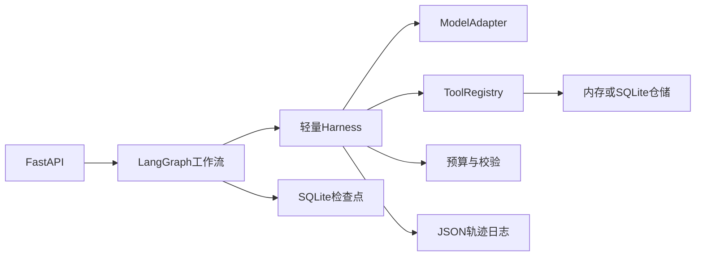

# LangGraph + 轻量 Harness MVP 计划

阶段 01。下一阶段是 [.cursor/plans/02-fatigue-regulation-retrieval.plan.md](.cursor/plans/02-fatigue-regulation-retrieval.plan.md)。

## MVP 范围与验收

- 聚焦一个场景：输入疲劳驾驶报警，查询车辆、驾驶员和历史报警，按确定性规则评分，再由模型生成符合 Schema 的研判报告；低置信度进入人工复核。
- 提供 `POST /api/v1/judgements`、`GET /api/v1/judgements/{task_id}` 和人工复核接口，并附可直接运行的演示脚本。
- Harness 首版只实现五项：模型适配、工具注册与参数校验、超时/重试/预算、结构化输出校验、执行轨迹。
- 验收要求：正常、高风险、证据不足、工具失败、模型输出非法、预算耗尽六类测试通过；同一 `thread_id` 可从 LangGraph 检查点恢复。
- 本阶段不引入 Kafka、Qdrant、Neo4j、YOLO、VLM、MCP 和前端；通过端口/协议保留后续替换边界，避免 MVP 被基础设施拖慢。

## 目标架构

## 实施步骤

1. **工程骨架与领域模型**
   - 新建 [`pyproject.toml`](pyproject.toml)，用 uv 管理 FastAPI、LangGraph、Pydantic、httpx、pytest、Ruff 等依赖；不创建项目私有虚拟环境。
   - 在 [`src/vehicle_agent/domain/models.py`](src/vehicle_agent/domain/models.py) 定义 `Alarm`、`VehicleContext`、`JudgementResult`、`HumanReview` 等 Pydantic 模型，在 [`src/vehicle_agent/config.py`](src/vehicle_agent/config.py) 集中管理模型端点、超时、重试和预算。
   - 在 [`src/vehicle_agent/repositories/`](src/vehicle_agent/repositories/) 提供仓储协议与内存实现，预置可重复的车辆、驾驶员和报警样本。
2. **实现轻量 Harness**
   - 在 [`src/vehicle_agent/harness/model.py`](src/vehicle_agent/harness/model.py) 定义模型无关的 `ModelAdapter`，实现 OpenAI-compatible 适配器和测试用 Fake Adapter。
   - 在 [`src/vehicle_agent/harness/tools.py`](src/vehicle_agent/harness/tools.py) 实现带 Pydantic 输入/输出 Schema 的 `ToolRegistry`，注册车辆查询和历史报警两个只读工具。
   - 在 [`src/vehicle_agent/harness/runtime.py`](src/vehicle_agent/harness/runtime.py) 统一执行超时、有限重试、最大调用次数/Token/耗时预算、输出校验和错误分类。
   - 在 [`src/vehicle_agent/harness/tracing.py`](src/vehicle_agent/harness/tracing.py) 记录 `task_id`、节点、工具、模型、耗时、状态与错误；写操作审批暂不实现，只预留 Policy 接口。
3. **实现 LangGraph 研判流程**
   - 在 [`src/vehicle_agent/graph/state.py`](src/vehicle_agent/graph/state.py) 定义类型化 `JudgementState`，在 [`src/vehicle_agent/graph/nodes.py`](src/vehicle_agent/graph/nodes.py) 实现校验、上下文查询、历史查询、规则评分、报告生成和人工复核节点。
   - 在 [`src/vehicle_agent/graph/builder.py`](src/vehicle_agent/graph/builder.py) 组装 `validate → context → history → score → report/review` 条件图，使用 SQLite Checkpointer 支持按 `thread_id` 恢复。
   - 风险分数由代码规则计算，模型只负责总结证据和生成建议；所有模型及工具调用必须经过 Harness，节点不直接访问模型。
4. **API、测试与演示**
   - 在 [`src/vehicle_agent/api/main.py`](src/vehicle_agent/api/main.py) 暴露创建任务、查询结果和提交人工复核接口，统一错误响应和任务状态。
   - 在 [`tests/`](tests/) 编写 Harness 单元测试、LangGraph 路由/恢复测试、API 集成测试；Fake Adapter 保证测试不依赖真实模型。
   - 在 [`scripts/demo.py`](scripts/demo.py) 串联一条完整报警研判，在 [`README.md`](README.md) 写明 uv 安装、启动、请求示例、架构和 MVP 边界。
   - 运行 Ruff、pytest 和演示脚本；按仓库规则在每个可独立回滚的阶段创建 Git commit，建议拆为“工程骨架”“Harness”“LangGraph流程”“API与测试”四个提交。

## MVP 后续扩展顺序

1. 将 ToolRegistry 工具封装为 MCP Server，同时保留 Harness 策略层。
2. 增加 Qdrant RAG 和 Neo4j 图谱节点。
3. 增加 YOLO/VLM 视觉证据节点。
4. 使用 PostgreSQL/Kafka 替换 MVP 的本地仓储与同步触发方式。
5. 增加 Prometheus/OpenTelemetry、Docker Compose 和自动评测集。

本计划是现有完整方案中“基础 Agent”部分的收敛版本，延续 [`docs/vehicle-risk-agent-implementation-plan.md`](docs/vehicle-risk-agent-implementation-plan.md) 中的 LangGraph 状态、确定性评分、结构化报告和人工复核原则。
