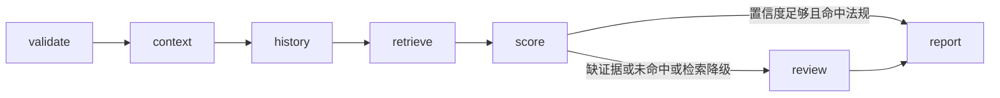

# 02 疲劳驾驶规则检索

阶段 01 是已完成的 LangGraph Harness MVP，见 [.cursor/plans/01-langgraph-harness-mvp.plan.md](.cursor/plans/01-langgraph-harness-mvp.plan.md)。本文件是阶段 02。下一阶段若做图谱证据，使用 `03-` 前缀。目录按文件名排序即执行顺序。

本阶段只证明一件事：法规摘录能作为只读工具进入现有研判，且不改变「代码评分、模型只写总结」的边界。延续 [docs/vehicle-risk-agent-implementation-plan.md](docs/vehicle-risk-agent-implementation-plan.md) 第 15 节的引用原则，Qdrant、混合检索和 Recall@K 留到后续替换 `RegulationIndex`。

## 流程

`retrieve` 只在前面节点成功时执行。检索返回空列表，或工具超时、失败、预算耗尽时，节点记录错误、写入 `regulation_status=degraded` 或 `miss`，然后继续 `score`。车辆查询和历史查询失败仍直接结束，行为与阶段 01 相同。

## 检索端口

- 在 `src/vehicle_agent/knowledge/` 增加 `RegulationIndex` 协议和关键词实现。样本放在 `src/vehicle_agent/knowledge/regulations/`，用 Markdown 标题和固定字段（`document_id`、`title`、`section`、`alarm_types`、正文）解析，不新增依赖。
- 正文使用项目自拟的疲劳驾驶处置摘录，不粘贴法规原文。匹配键只有 `alarm_type`，由 `retrieve` 节点传入，模型不生成查询。
- 在 [src/vehicle_agent/harness/tools.py](src/vehicle_agent/harness/tools.py) 注册只读工具 `search_regulations`。`build_vehicle_tools` 默认装上包内索引，测试可注入空索引或失败索引。
- 输出为摘录列表：文档标识、标题、章节、短摘录。空列表是正常结果，不是异常。

## 图、状态与评分

- [src/vehicle_agent/graph/state.py](src/vehicle_agent/graph/state.py) 增加 `regulations`、`regulation_status`（`hit`、`miss`、`degraded`），`Route` 增加 `retrieve`。
- [src/vehicle_agent/graph/builder.py](src/vehicle_agent/graph/builder.py) 将 `history` 的成功出口从 `score` 改为 `retrieve`，`retrieve` 再进入 `score`。
- [src/vehicle_agent/domain/models.py](src/vehicle_agent/domain/models.py) 的 `Evidence.type` 增加 `document`。引用放在现有 `source` 和 `description` 中，例如来源 `fatigue-rules`、描述包含标题和章节。
- [src/vehicle_agent/graph/scoring.py](src/vehicle_agent/graph/scoring.py) 仍独占 `risk_score`、`risk_level`、`alarm_validity`。命中时追加 `document` 证据，置信度小幅上调并保持 0.95 上限，风险分不变，因此现有 `risk_score == 1.0` 断言继续成立。未命中或降级时降低置信度，并把 `requires_human_review` 置为真。缺车辆或驾驶员时，即使命中法规也仍要复核。
- [src/vehicle_agent/graph/nodes.py](src/vehicle_agent/graph/nodes.py) 的报告提示词要求只引用给定摘录，`prompt_version` 改为 `report-v2`。法规内容进入报告节点的用户消息，不进入评分。

## 验收

- 命中：结果证据含 `document`，状态与阶段 01 的正常、高风险用例一致，仍为 `completed`。
- 未命中：任务完成到人工复核，证据说明缺少法规依据，模型未改风险分。
- 检索失败或预算耗尽：状态为 `awaiting_review`，错误被记录，不把整单标为 `failed`。
- 阶段 01 的工具失败、非法模型输出、模型预算耗尽和检查点恢复测试保持通过。
- 更新 [README.md](README.md)：本阶段包含本地规则检索；仍然不包含 Qdrant、Neo4j、YOLO、MCP、Kafka 和前端。

测试通过后按仓库规则提交一次中文 commit。图谱、工单和 MCP 不在本阶段实现。
