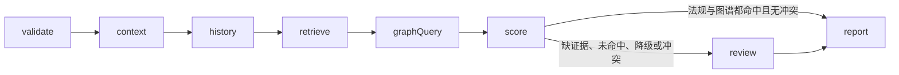

# 03 疲劳驾驶图谱证据

上一阶段是已实现的本地法规检索，见 [.cursor/plans/02-fatigue-regulation-retrieval.plan.md](.cursor/plans/02-fatigue-regulation-retrieval.plan.md)。本文件是阶段 03。下一阶段是 [.cursor/plans/04-neo4j-graph-index.plan.md](.cursor/plans/04-neo4j-graph-index.plan.md)，用 Neo4j 替换图存储。本阶段不创建该文件。延续 [docs/vehicle-risk-agent-implementation-plan.md](docs/vehicle-risk-agent-implementation-plan.md) 第 15.4 节：固定关系、一到两跳、图谱结果变成可引用证据；冲突必须显式说明。Qdrant、MCP、视觉和工单留到后续。

本阶段只证明一件事：车辆、驾驶员、设备和故障关系能作为只读证据进入现有研判，且不改变「代码评分、模型只写总结」。

## 流程

`graphQuery` 只在 `retrieve` 之后执行，包括法规未命中或降级。图谱返回空列表，或工具超时、失败、预算耗尽时，节点记录错误、写入 `graph_status=miss` 或 `degraded`，然后继续 `score`。车辆查询和历史查询失败仍直接结束。

## 图谱端口

- 在 [src/vehicle_agent/knowledge/graph.py](src/vehicle_agent/knowledge/graph.py) 增加 `GraphIndex` 协议和 `MemoryGraphIndex`。事实用代码内的固定三元组，不新增依赖，不读取外部数据库。
- 关系只保留三条：`drives`（车辆—驾驶员）、`installed_with`（车辆—设备）、`has_fault`（设备—故障）。查询由节点传入 `vehicle_id` 与 `device_id`，模型不生成查询。从车辆出发最多两跳。
- 种子覆盖现有可完成用例：`vehicle_001`/`driver_001`/`device_001` 与 `vehicle_002`/`driver_002`/`device_002` 均无故障。另备 `device_003` 的未关闭故障 `camera_occlusion`，供冲突测试使用。
- 在 [src/vehicle_agent/harness/tools.py](src/vehicle_agent/harness/tools.py) 注册只读工具 `query_vehicle_graph`。`build_vehicle_tools` 增加可选 `graph` 参数，默认装上种子图；测试可注入空图或失败图。
- 输出为事实列表：关系、起点、终点、一句说明。空列表是正常结果。

## 图、状态与评分

- [src/vehicle_agent/graph/state.py](src/vehicle_agent/graph/state.py) 增加 `graph_facts`、`graph_status`（`hit`、`miss`、`degraded`），`Route` 增加 `graph`。
- [src/vehicle_agent/graph/builder.py](src/vehicle_agent/graph/builder.py) 将 `retrieve` 的下一节点改为 `graph`，`graph` 再进入 `score`。
- [src/vehicle_agent/domain/models.py](src/vehicle_agent/domain/models.py) 的 `Evidence.type` 增加 `graph`。引用放在现有 `source` 和 `description` 中。
- [src/vehicle_agent/graph/scoring.py](src/vehicle_agent/graph/scoring.py) 仍独占 `risk_score`、`risk_level`、`alarm_validity`。图谱命中且无冲突时追加 `graph` 证据，置信度加 `0.05`，上限仍为 `0.95`，风险分不变。未命中或降级时降低置信度，`requires_human_review` 为真。法规已命中且图谱含 `camera_occlusion` 故障时视为冲突：两边证据都保留，说明冲突，风险分不变，并进入人工复核。缺车辆或驾驶员时，即使图谱命中也仍要复核。
- [src/vehicle_agent/graph/nodes.py](src/vehicle_agent/graph/nodes.py) 把图谱事实放进报告用户消息。提示词要求只引用给定关系，没有 `graph` 证据时不编造车辆、设备或故障关系。`prompt_version` 改为 `report-v3`。
- 冲突用例需要仓储里有对应车辆。在 [src/vehicle_agent/repositories/memory.py](src/vehicle_agent/repositories/memory.py) 增加 `vehicle_003`/`device_003`，默认演示路径仍用 `vehicle_001` 和 `vehicle_002`。

## 验收

- 命中：`vehicle_001` 高风险结果仍为 `completed`，`risk_score == 1.0`，证据同时含 `document` 与 `graph`。
- 未命中：注入空图后进入人工复核，风险分不被模型修改。
- 图谱失败或预算耗尽：状态为 `awaiting_review`，错误被记录，整单不标为 `failed`。现有 `max_tool_calls=2` 的法规预算测试保持原断言；另加 `max_tool_calls=3`，使法规检索成功、图谱调用耗尽预算。
- 冲突：`device_003` 的遮挡故障与疲劳驾驶法规摘录同时出现，状态为 `awaiting_review`，两类证据都在，风险分与无故障时的同一车速规则一致。
- 阶段 01、02 的正常完成、工具失败、非法模型输出、模型预算耗尽和检查点恢复测试保持通过。
- 更新 [README.md](README.md)：本阶段包含本地图谱关系；仍然不包含 Neo4j、Qdrant、YOLO、MCP、Kafka 和前端。
- 将阶段 02 计划中的下一阶段指向本文件。

测试通过后按仓库规则提交一次中文 commit。
