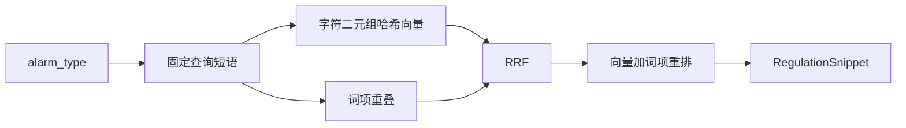

# 06 混合法规检索

上一阶段是已实现的 Qdrant 法规索引，见 [.cursor/plans/05-qdrant-regulation-index.plan.md](.cursor/plans/05-qdrant-regulation-index.plan.md)。本文件是阶段 06。下一阶段做 MCP 工具网关时使用 [.cursor/plans/07-mcp-tool-gateway.plan.md](.cursor/plans/07-mcp-tool-gateway.plan.md)，本阶段不创建该文件。延续 [docs/vehicle-risk-agent-implementation-plan.md](docs/vehicle-risk-agent-implementation-plan.md) 第 15.3 节的向量检索、关键词检索、RRF 和重排，以及第 4 周的 Recall@K。图谱融合已在阶段 03、04 完成。视觉、工单和 Kafka 继续留到后续。

本阶段只证明一件事：法规摘录按混合检索排序，固定评测集的 Recall@K 可重复，且不改变「代码评分、模型只写总结」。

不引入 Embedding 模型、Reranker 模型和网络请求。向量、关键词和重排都在进程内用固定算法计算，使默认 pytest 不依赖 Qdrant、GPU 或在线模型。Qdrant 只保存这些向量并执行带过滤的余弦检索。

## 流程

研判图保持 `validate → context → history → retrieve → graph → score → report/review`。[src/vehicle_agent/graph/nodes.py](src/vehicle_agent/graph/nodes.py) 的 `retrieve` 仍只调用 `search_regulations`，入参仍只有 `alarm_type`。查询短语由代码按报警类型查表得到，模型不生成查询。连接失败、查询失败和预算耗尽仍写成 `regulation_status=degraded`。过滤后没有章节仍是 `miss`。`prompt_version`、风险分和冲突规则不改。

## 语料与查询

- 保留 [src/vehicle_agent/knowledge/regulations/fatigue-driving.md](src/vehicle_agent/knowledge/regulations/fatigue-driving.md) 现有两节的 `document_id`、标题、章节和正文。另加项目自拟章节，覆盖手机使用、超速、摄像头遮挡，以及至少一节同属 `driver_fatigue` 的干扰项。干扰项不得排到固定疲劳查询的第一名。
- 在 [src/vehicle_agent/knowledge/index.py](src/vehicle_agent/knowledge/index.py) 为已有报警类型登记固定查询短语。`driver_fatigue` 的短语要能把「第2节 行驶中的报警」排在同类型干扰项之前，从而现有研判里第一条文档证据仍是 `fatigue-rules`。
- `RegulationIndex.search(alarm_type)` 签名不变。索引内部用固定短语做混合检索，再按 `alarm_types` 过滤。评测可以传入覆盖短语，工具 [SearchRegulationsInput](src/vehicle_agent/harness/tools.py) 不增加字段。

## 混合排序

Markdown 与 Qdrant 共用同一套排序，避免两个后端各写一套融合。

- 向量：对「标题 + 章节 + 摘录」和查询短语做字符二元组哈希，维度固定为 128，余弦相似度。去掉常量 `REGULATION_VECTOR = [1.0]`。
- 关键词：同一分词方式的词项重叠，不引入检索库。
- 两路各自取候选，用 Reciprocal Rank Fusion（`k=60`）合并。
- 重排只作用于融合后的前若干条，分数为余弦与词项重叠的固定加权，并列时按 `document_id`、`section` 稳定排序。
- 研判返回该报警类型过滤后的有序列表。命中仍只加一次置信度，风险分不随条数变化。

## Qdrant

- 集合名仍为 `regulations`。向量维度改为 128，距离仍为余弦。`ensure_ready` 发现已有集合维度不是 128 时删除并重建，再幂等 upsert。重复启动不新增点。
- 查询使用带 `alarm_types` 过滤的向量检索。关键词和 RRF 用同一 payload 在进程内计算，使假客户端测试与真实库使用同一排序结果。
- 假客户端补上向量查询记录。现有过滤、幂等和异常向上抛出的断言保持成立，只把常量向量断言改成哈希向量。

## 验收

- 排序单测：构造向量名次与关键词名次不一致的候选，RRF 加重排后的第一条是预先标好的章节。
- 固定评测集放在仓库内，每条含查询短语、可选报警类型和相关 `document_id`/`section`。断言 Recall@1 与 Recall@3 的精确值，不使用浮动阈值。无相关章节的查询，第一条不是任意种子章节的误标相关。
- `driver_fatigue` 的研判第一条文档证据仍是 `fatigue-rules`，且描述仍含「第2节」。`vehicle_001` 完成态、`risk_score == 1.0`、`vehicle_003` 冲突进 `awaiting_review`、检索失败降级这些断言保持通过。
- 默认 pytest 不连接 Qdrant。交付前另跑 `VEHICLE_AGENT_RUN_QDRANT=1` 的 [tests/test_qdrant_acceptance.py](tests/test_qdrant_acceptance.py)：真实库的混合排序与 Markdown 后端一致，并覆盖完成、冲突、失败和未命中。
- 更新 [README.md](README.md)：法规检索是混合排序，默认仍读仓库 Markdown。仍然不包含神经网络 Embedding、YOLO、MCP、Kafka 和前端。
- 将阶段 05 计划中的下一阶段指向本文件。

测试通过后按仓库规则提交一次中文 commit。
