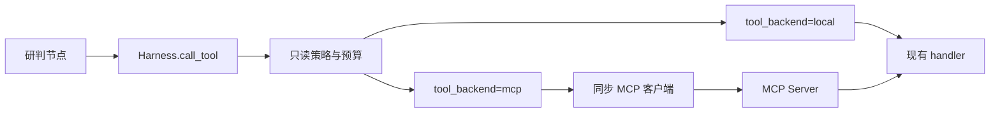

# 07 MCP 工具网关

上一阶段是已完成的混合法规检索，见 [.cursor/plans/06-hybrid-regulation-retrieval.plan.md](.cursor/plans/06-hybrid-regulation-retrieval.plan.md)。本文件是阶段 07，落地到 [.cursor/plans/07-mcp-tool-gateway.plan.md](.cursor/plans/07-mcp-tool-gateway.plan.md)。下一阶段是 [.cursor/plans/08-image-vision.plan.md](.cursor/plans/08-image-vision.plan.md)。延续 [docs/vehicle-risk-agent-implementation-plan.md](docs/vehicle-risk-agent-implementation-plan.md) 第 14.1 节里已经存在的车辆、报警和知识查询，以及第 6 周「通过 MCP 查询、故障可重试或降级」。`vision-mcp`、`workorder-mcp`、Skill、Kafka 和前端继续留到后续。

本阶段只证明一件事：研判图里的四次工具调用可以走 MCP `tools/call`，入参和出参与现在的 Pydantic 模型一致，且不改变「代码评分、模型只写总结」。

## 流程

研判图保持 `validate → context → history → retrieve → graph → score → report/review`。[src/vehicle_agent/graph/nodes.py](src/vehicle_agent/graph/nodes.py) 仍只调用 `get_vehicle_context`、`list_recent_alarms`、`search_regulations`、`query_vehicle_graph`。`prompt_version`、风险分和冲突规则不改。

## 工具契约

服务端不重写查询。它调用现有 [build_vehicle_tools](src/vehicle_agent/harness/tools.py)，把每个 `RegisteredTool` 注册成 MCP 工具：

- 名称和描述沿用注册表。
- 入参 Schema 使用 `input_model.model_json_schema()`。
- 返回 `output_model.model_dump(mode="json")`。
- 四个工具都是只读，幂等策略写成可安全重试。超时仍用 Harness 已有的 `request_timeout_seconds`，MCP 层不再套第二套重试。
- 每个工具声明固定角色 `monitor`。调用方角色来自配置，默认 `monitor`。角色不符时返回稳定错误，客户端映射为现有 `PolicyDeniedError`，不重试。

服务端进程用 `build_seed_repository()`、`open_regulation_index` 和 `open_graph_index` 装配依赖，因此它读到的种子与 API 默认种子相同。法规和图谱后端继续由现有配置决定。阶段验收固定使用 Markdown 和内存图，不额外依赖 Qdrant 或 Neo4j。

## 客户端与装配

- 在 [pyproject.toml](pyproject.toml) 增加 `mcp`，并用 `uv pip install` 装进 `D:\uv_venv`。
- 在 [src/vehicle_agent/config.py](src/vehicle_agent/config.py) 增加 `tool_backend`（`local` 或 `mcp`，默认 `local`）和 `mcp_role`（默认 `monitor`）。
- `local` 时 [src/vehicle_agent/api/main.py](src/vehicle_agent/api/main.py) 仍把 `build_vehicle_tools` 交给 Harness。
- `mcp` 时客户端注册同名的四个工具。handler 只做 MCP `tools/call`，再用原来的 `output_model` 校验。Harness 的参数校验、只读策略、预算、超时和重试保持在客户端。
- MCP SDK 的会话是异步的。用一个随应用启动的后台会话把它收成同步调用，供现有同步 `Harness.call_tool` 使用。应用关闭时关闭会话。
- 连接失败、协议错误和工具 `isError` 映射为现有 `ToolExecutionError`。挂起映射为现有 `HarnessTimeoutError`。二者都已由 `_is_retryable` 重试。重试耗尽后，`retrieve` 和 `graph` 仍写 `degraded`；`context` 和 `history` 仍让整单 `failed`。本阶段不把后两个节点改成降级。

默认 pytest 不启动子进程。`tool_backend=mcp` 的单元测试使用 SDK 的进程内内存传输。交付前另跑 stdio：`VEHICLE_AGENT_RUN_MCP=1` 时用 `python -m vehicle_agent.mcp` 拉起独立进程，写法对齐 [tests/test_qdrant_acceptance.py](tests/test_qdrant_acceptance.py)。不往 Compose 增加服务。

## 验收

- 契约：`tools/list` 含四个工具名，入参 Schema 与对应 Pydantic 模型一致。`driver_fatigue` 的 `search_regulations` 与本地注册表返回同一摘录。未知工具和角色不符分别得到工具错误和 `PolicyDeniedError`。
- 研判：`tool_backend=mcp` 时 `vehicle_001` 为 `completed`，`risk_score == 1.0`，第一条文档证据仍是 `fatigue-rules` 且含「第2节」，证据同时含 `document` 与 `graph`。轨迹里的四次工具调用都记在 MCP 客户端上。
- 降级：法规工具返回错误时，先按 `max_retries` 重试，随后 `regulation_status=degraded`，状态为 `awaiting_review`，整单不标为 `failed`。图谱工具错误同样进入现有 `graph_status=degraded`。
- 会话起不来时，失败发生在 `context`，错误码仍是现有 Harness 错误，评分规则不被绕过。
- 阶段 01 至 06 的完成、未命中、降级、冲突、预算和检查点测试保持通过。默认 pytest 仍走 `tool_backend=local`。
- 更新 [README.md](README.md)：可用配置改为 MCP；默认仍是进程内工具。仍然不包含神经网络 Embedding、YOLO、视觉 MCP、工单 MCP、Kafka 和前端。

测试通过后按仓库规则提交一次中文 commit。
