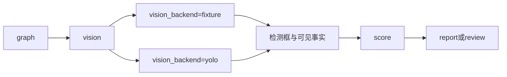

# 08 图片视觉

上一阶段是已完成的 MCP 工具网关，见 [.cursor/plans/07-mcp-tool-gateway.plan.md](.cursor/plans/07-mcp-tool-gateway.plan.md)。本文件是阶段 08，落地到 [.cursor/plans/08-image-vision.plan.md](.cursor/plans/08-image-vision.plan.md)。下一阶段做视频分析时再写 `.cursor/plans/09-video-analysis.plan.md`，本阶段不创建该文件。延续 [docs/vehicle-risk-agent-implementation-plan.md](docs/vehicle-risk-agent-implementation-plan.md) 第 7 周和第 16.1、16.4 节：图片检测框、类别、置信度进入证据链，视觉大模型只复核可见事实。`vision-mcp`、视频抽帧、工单、Skill、Kafka 和前端继续留到后续。

本阶段只证明一件事：带 `image_id` 的报警能得到检测框并写入证据，且不改变「代码评分、模型不能改风险分」。没有图片的现有报警保持阶段 01 至 07 的分数和状态。

默认检测器是仓库内的定样本目录，默认 pytest 不安装、不加载 YOLO，也不调用在线视觉模型。YOLO 只作为可选后端，由 `VEHICLE_AGENT_RUN_YOLO=1` 单独验收。

## 流程

研判图改为 `validate → context → history → retrieve → graph → vision → score → report/review`。[src/vehicle_agent/graph/builder.py](src/vehicle_agent/graph/builder.py) 在 `graph` 与 `score` 之间插入 `vision`。节点直接调用 `VisionIndex`，不注册第五个工具，因此 [src/vehicle_agent/mcp/server.py](src/vehicle_agent/mcp/server.py) 的四个只读工具和 MCP 契约不变。

没有 `image_id` 时 `vision_status=skipped`，不调用检测器和模型。[src/vehicle_agent/graph/scoring.py](src/vehicle_agent/graph/scoring.py) 对 skipped 完全忽略，`risk_score`、置信度和复核条件和现在一致。

## 检测契约

在 [src/vehicle_agent/domain/models.py](src/vehicle_agent/domain/models.py) 为 `Alarm` 增加可选 `image_id`。`Evidence.type` 增加 `vision`。检测结果单独建模，不塞进自由文本：

- 类别只允许第 16.1 节的七个标签：`driver`、`mobile_phone`、`seat_belt`、`closed_eye`、`yawn`、`smoking`、`camera_occlusion`。
- `bbox` 为归一化 `xyxy`，范围 0 到 1。
- 每条检测带 `confidence` 和 `model_version`。

`VisionIndex` 放在新的 `src/vehicle_agent/knowledge/vision.py`。配置项 `vision_backend` 为 `fixture` 或 `yolo`，默认 `fixture`。

- `fixture`：读取包内 JSON 目录。至少三条样本：`closed_eye` 命中、`camera_occlusion` 冲突、空结果未命中。未知 `image_id` 视为未命中，不是异常。
- `yolo`：可选依赖，不写入默认安装。只在验收开关打开时解码上传文件并映射到上述七个标签。权重路径由配置给出。连接、加载或推理失败映射为 `vision_status=degraded`。

`POST /api/v1/vision/images` 接收 `image_id` 和文件。fixture 只按 `image_id` 查目录，不解码像素。响应返回检测框、类别和置信度。研判节点调用同一个 `VisionIndex`。

## 评分与复核

视觉结果不改变 `risk_score`。这是本阶段和法规、图谱加分的差别，用来保证无图用例的 `risk_score == 1.0` 继续成立。

- 命中：存在置信度不低于 0.6 的 `closed_eye` 或 `yawn` 时，置信度加现有 `_HIT_BONUS`（0.05），并写入 `vision` 证据。
- 冲突：法规为 `hit`，且存在置信度不低于 0.6 的 `camera_occlusion` 时，置信度减 `_MISS_PENALTY`，状态为 `awaiting_review`。`risk_score` 与同一车速、无图片时一致。检测证据和法规摘录都保留。
- 未命中：有图片但没有检测时，置信度减 `_MISS_PENALTY`，进入复核，整单不标为 `failed`。
- 失败：检测器错误时 `vision_status=degraded`，错误写入 `errors`，状态为 `awaiting_review`，整单不标为 `failed`。

有检测时，视觉节点再用现有 `complete_structured` 做一次文本复核。输入只有检测 JSON，不传像素。输出固定为 `visible_facts`。这些事实写入证据描述。复核失败记为降级并进入人工复核，已得到的检测框保留。`risk_score`、`risk_level` 和 `alarm_validity` 在写入事实前后相同；测试用两份不同的 `visible_facts` 证明模型不能改分。

报告提示增加一句：没有 `vision` 证据时不要编造检测框或画面事实。`prompt_version` 改为 `report-v4`。无图路径不增加模型调用，现有 `max_model_calls=0` 测试保持失败发生在 `report`。

## 验收

- 无图：`vehicle_001` 仍为 `completed`，`risk_score == 1.0`，证据不含 `vision`。阶段 01 至 07 的完成、未命中、降级、冲突、预算、检查点和 MCP 四工具测试保持通过。
- 命中：`closed_eye` 样本进入完整研判，证据含 `vision` 和归一化框，`risk_score` 仍为 1.0，`visible_facts` 存在。
- 冲突：`camera_occlusion` 样本与法规摘录同时出现，状态为 `awaiting_review`，两类证据都保留，风险分与无图时的同一车速规则一致。
- 上传：fixture 下用样本 `image_id` 调用 `POST /api/v1/vision/images`，返回对应类别、框和置信度。
- 失败：检测器抛错时 `vision_status=degraded`，状态为 `awaiting_review`，整单不标为 `failed`。
- YOLO：默认 pytest 不运行。`VEHICLE_AGENT_RUN_YOLO=1` 且权重存在时，对一张本地图片返回七类标签之内的框。不往 Compose 增加服务。

更新 [README.md](README.md)：默认定样本视觉；YOLO 可选且不在默认测试中。仍然不包含视觉 MCP、视频、工单 MCP、Kafka 和前端。把阶段 07 计划中的下一阶段指向本文件。

测试通过后按仓库规则提交一次中文 commit。
