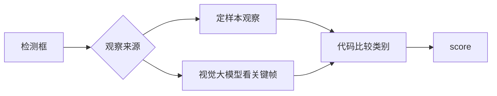

# 10 关键帧画面复核

上一阶段是已完成的视频分析，见 [.cursor/plans/09-video-analysis.plan.md](.cursor/plans/09-video-analysis.plan.md)。本文件是阶段 10，落地到 [.cursor/plans/10-keyframe-visual-review.plan.md](.cursor/plans/10-keyframe-visual-review.plan.md)。下一阶段接入真实媒体时再写 `.cursor/plans/11-real-media-vision.plan.md`，本阶段不创建该文件。延续 [docs/vehicle-risk-agent-implementation-plan.md](docs/vehicle-risk-agent-implementation-plan.md) 第 16.4 节：复核描述关键帧里看得见的类别，且不能覆盖检测和业务数据。第 18 节的文本侧微调保持省略。

本阶段只证明一件事：已有检测结果时，复核得到一份与检测框分开的画面观察；观察不支持检测类别时进入人工复核，两边证据都保留，且不改变「代码评分、模型不能改风险分」。观察有两个来源，比较函数只有一个。默认定样本按 `image_id` 查表。复核后端为 `vlm` 时，视觉大模型看已保存的关键帧图片，输出同一套标签后再比较。没有图片或视频的报警保持阶段 01 至 09 的分数和状态。

默认 pytest 不解码像素，也不调用视觉大模型。真实调用只在 `VEHICLE_AGENT_RUN_VLM=1` 时单独验收。

## 流程

研判图仍是 `validate → context → history → retrieve → graph → vision → score → report/review`。不新增节点，也不注册 MCP 工具。[src/vehicle_agent/graph/nodes.py](src/vehicle_agent/graph/nodes.py) 的 `_review_detections` 不再调用 `complete_structured`。有检测时取得画面观察，再由代码比较类别。视频仍先聚合，只复核关键帧对应的 `image_id`。

## 画面观察

在 [src/vehicle_agent/knowledge/vision.py](src/vehicle_agent/knowledge/vision.py) 旁增加观察目录，例如 `vision_fixtures/observations.json`。每条是 `image_id` 到第 16.1 节标签列表，不保存像素，也不保存自由文本：

- `image_closed_eye`：`["closed_eye"]`，与现有检测一致。
- `image_camera_occlusion`：`["camera_occlusion"]`，与现有检测一致。
- `image_closed_eye_mismatch`：检测仍是 `closed_eye`，观察为 `["driver"]`，不支持闭眼。

未知 `image_id` 的观察视为读取失败，不是「观察为空」。观察为空列表表示这张图没有支持任何检测类别。`image_empty` 没有检测，不读取观察。

比较是纯函数，只看置信度不低于 0.6 的检测类别是否都出现在观察标签里。不比较框的坐标。观察里多出来的标签记入证据，不单独触发冲突。

- 一致：`vlm_status=hit`，`visible_facts` 由代码写成「画面观察支持 …」，证据同时保留检测框。
- 不一致：`vlm_status=hit`，另记 `vision_agreement=conflict`。证据写明检测类别和观察不支持的类别。
- 失败：观察读取失败时 `vlm_status=degraded`，`visible_facts` 为空，检测框保留。

## 视觉大模型

视觉大模型是观察的另一个来源，不是另一套评分。配置增加复核后端，默认 `fixture`。设为 `vlm` 时才看图。

上传接口 `POST /api/v1/vision/images` 把图片按 `image_id` 存到本地目录。研判在后端为 `vlm` 时按这个 id 读取字节；定样本后端继续忽略字节。视频聚合出的关键帧沿用同一个 `image_id`。本阶段不从视频文件里抽图像，没有对应图片文件时按观察失败处理。

调用走现有 Harness。只发送这一张关键帧，消息带图片，温度 0，要求输出 JSON 标签列表。模型名和接口与写报告的文本模型分开配置。返回标签必须落在第 16.1 节的七类里，无法识别的标签丢弃；全部无法识别或响应不是 JSON 时视为调用失败。得到的标签列表进入上面的同一比较函数。

调用失败、超时或字节缺失时 `vlm_status=degraded`，检测框保留，进入人工复核，整单不标为 `failed`。trace 留下模型名、`image_id`、提示版本和返回标签，供回放。这对应第 16.4 节。

`VEHICLE_AGENT_RUN_VLM=1` 且本机有图片和兼容接口时，验收这些标签进入比较函数，而不只是标签合法。不把该调用放进默认测试，不往 Compose 增加服务。

## 评分

`risk_score` 仍不因观察文本、观察来源或是否一致而改变。一致的 `closed_eye` 或 `yawn` 继续加 `_HIT_BONUS`。遮挡与法规冲突沿用现有规则。

不一致时置信度减 `_MISS_PENALTY`，状态为 `awaiting_review`，整单不标为 `failed`。`risk_score` 与同一车速、同一检测、观察一致时一致。观察读取失败和视觉模型失败都沿用 `vlm_status=degraded` 进入复核。

报告节点仍只写 `summary` 和 `recommendations`。提示增加一句：画面是否支持检测类别以证据中的观察结论为准，不要改写。`prompt_version` 改为 `report-v6`。无图、无视频路径不增加模型调用；定样本路径的模型调用只发生在 `report`。`vlm` 路径除报告外，只为这一张关键帧增加一次视觉模型调用。

## 验收

- 无图：阶段 08、09 的无图、连续命中、单帧、遮挡视频、未命中和检测失败测试保持通过，`risk_score` 不变。`video_fatigue` 的可见事实改为观察目录中的固定说法，不再来自 `FakeModelAdapter`。
- 一致：`image_closed_eye` 配合 `vehicle_001` 的高速报警为 `completed`，`risk_score == 1.0`，证据含检测框和「画面观察支持 closed_eye」。
- 不一致：`image_closed_eye_mismatch` 状态为 `awaiting_review`，检测框和观察结论都保留，`risk_score` 与观察一致的同一车速、同一检测相同。
- 失败：观察读取抛错时 `vlm_status=degraded`，状态为 `awaiting_review`，整单不标为 `failed`。
- 模型预算：定样本有图研判不再为画面复核消耗一次 `complete_structured`。现有 `max_model_calls=0` 的无图失败测试仍失败在 `report`。
- 视觉模型：默认 pytest 不运行。`VEHICLE_AGENT_RUN_VLM=1` 时，一张已保存关键帧的返回标签进入比较函数；接口失败时 `vlm_status=degraded`，检测框仍在。

更新 [README.md](README.md)：画面复核读取独立观察并比较类别；默认定样本。视觉大模型只在复核后端为 `vlm` 时看已保存关键帧，且不在默认测试中。把阶段 09 计划中的下一阶段从 `10-lora-experiment.plan.md` 指向本文件。

## 仍留到后续

这些不在本阶段实现：

- 研判节点目前调用 `vision_index.analyze(alarm.image_id)`，不传图片字节。[YoloVisionIndex](src/vehicle_agent/knowledge/vision.py) 因此不会在研判中推理；YOLO 只在上传接口、且后端被显式打开时运行。下一阶段再把字节交给 YOLO。
- [ffmpeg_sample_timestamps](src/vehicle_agent/knowledge/video.py) 只在可选验收里读时间戳，不把帧交回时间轴。下一阶段再用 FFmpeg 从短视频抽出关键帧图像。OpenCV、RTSP 和循环视频流仍不纳入。
- 目标跟踪、`vision-mcp`、检测结果可视化、事件入库和批量推理仍未做，继续留在真实媒体阶段之后。工单、Skill、Kafka 和前端也仍在其后。

测试通过后按仓库规则提交一次中文 commit。阶段 10 的计划只保留本文件。
