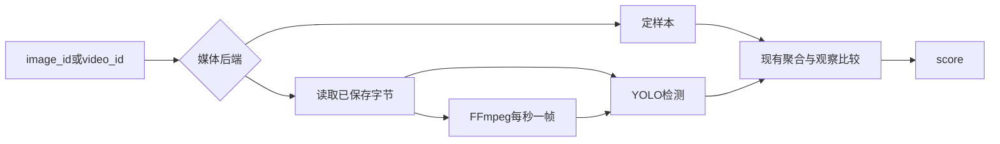

# 11 真实媒体视觉

上一阶段是已落地的关键帧画面复核，见 [.cursor/plans/10-keyframe-visual-review.plan.md](.cursor/plans/10-keyframe-visual-review.plan.md)。本文件是阶段 11，落地到 [.cursor/plans/11-real-media-vision.plan.md](.cursor/plans/11-real-media-vision.plan.md)。下一阶段再写 `.cursor/plans/12-vision-mcp.plan.md`，本阶段不创建该文件。延续 [docs/vehicle-risk-agent-implementation-plan.md](docs/vehicle-risk-agent-implementation-plan.md) 第 16.2 节里尚未接上的两步：研判时把图片字节交给检测器，以及用 FFmpeg 从短视频抽出帧并回到现有时间轴。目标跟踪、检测可视化、事件入库、批量推理、OpenCV、RTSP、循环视频流、工单、Skill、Kafka 和前端仍不纳入。

阶段 10 的代码和 README 已经完成，计划待办仍是 pending。落盘本文件时把那四项改为 completed。

本阶段只证明一件事：已保存的图片和短视频能进入现有检测、连续帧聚合和画面复核，且不改变「代码评分、模型不能改风险分」。`vision_backend=fixture` 且 `video_backend=fixture` 时，无图、定样本图片和定样本视频的分数与状态与阶段 10 一致。默认 pytest 不解码像素、不调用 FFmpeg、不加载 YOLO。

## 流程

研判图仍是 `validate → context → history → retrieve → graph → vision → score → report/review`。不新增节点，也不注册 MCP 工具。

## 图片字节

[src/vehicle_agent/graph/nodes.py](src/vehicle_agent/graph/nodes.py) 的 `analyze_vision` 现在调用 `vision_index.analyze(alarm.image_id)`，不传字节。[YoloVisionIndex.analyze](src/vehicle_agent/knowledge/vision.py) 在没有 `content` 时直接失败。上传接口已经用 [store_image](src/vehicle_agent/knowledge/vision.py) 把文件存到 `vision_store_dir`。

- `vision_backend=fixture`：继续只按 `image_id` 查定样本，忽略磁盘上的字节。现有测试不需要先存图。
- `vision_backend=yolo`：按 `image_id` 调用已有的 `read_stored_image`，再 `analyze(image_id, content)`。缺文件、空文件或 YOLO 抛错时走现有降级：`vision_status=degraded`，状态 `awaiting_review`，整单不标为 `failed`。
- 把 `vision_store_dir` 传进 `make_nodes`。定样本观察和 `vlm` 读图逻辑不改。

## 短视频抽帧

配置增加 `video_backend`，默认 `fixture`。可取 `ffmpeg`。

[FixtureVideoTimeline.analyze](src/vehicle_agent/knowledge/video.py) 继续忽略文件字节，仍读 `video_fixtures/catalog.json`。上传接口在两种后端下都把视频按 `video_id` 存到同一媒体目录，校验规则与 `image_id` 相同，拒绝路径片段。fixture 的返回值仍只来自目录，所以现有上传测试不解码。

`video_backend=ffmpeg` 时：

- 研判和上传都读取已保存的视频文件。没有文件时 `vision_status=degraded`，进入人工复核，整单不标为 `failed`。
- 在现有 `ffmpeg_sample_timestamps` 旁增加抽帧函数：每秒一帧，输出 JPEG 字节和时间戳。用 FFmpeg 写临时图片，不用 OpenCV。
- 每帧 `image_id` 为 `{video_id}__{序号}`，用 `store_image` 保存。`face_quality` 缺省为 1。检测调用同一个 `VisionIndex.analyze(image_id, jpeg)`，再交给现有 `aggregate_frames`。关键帧仍由聚合函数选出，画面复核仍只看这一帧的 `image_id`。
- 抽帧或检测失败时沿用时间轴失败的降级，不把整单标为 `failed`。

`VEHICLE_AGENT_RUN_FFMPEG=1` 且本机有 `ffmpeg` 和本地短视频时，验收抽出的 JPEG 和时间戳间隔约为 1 秒，并进入 `aggregate_frames`。不把该调用放进默认测试，不往 Compose 增加服务，不新增 Python 依赖。

## 评分

`risk_score` 不因字节来源、是否抽帧或检测器种类而改变。连续命中、单帧、遮挡和观察冲突沿用阶段 09、10 的规则。报告提示不改，`prompt_version` 保持 `report-v6`。无图、无视频路径不增加模型调用。

## 验收

- 定样本：阶段 08 至 10 的无图、闭眼、遮挡、不一致、连续命中、单帧和降级测试保持通过，`risk_score` 不变。
- 图片字节：注入一个只有收到字节才返回检测的 `VisionIndex`。已保存图片的研判能拿到检测框并进入现有观察比较。缺文件时 `vision_status=degraded`，状态为 `awaiting_review`。
- 抽帧：注入假的抽帧函数，不调用 FFmpeg。两秒以上的帧经 `aggregate_frames` 形成事件，帧图片写入媒体目录，检测器收到 JPEG 字节。单帧仍不形成事件。
- 视频缺失：`video_backend=ffmpeg` 且磁盘上没有该 `video_id` 时降级并进入复核，整单不标为 `failed`。
- 可选验收：`VEHICLE_AGENT_RUN_FFMPEG=1` 断言真实抽帧的 JPEG 与约 1 秒间隔。`VEHICLE_AGENT_RUN_YOLO=1` 仍只验收标签和归一化框，并确认调用方传入的是文件字节。

更新 [README.md](README.md)：默认定样本；YOLO 研判读取已保存图片；FFmpeg 只在 `video_backend=ffmpeg` 时抽帧，且不在默认测试中。把阶段 10 计划中的下一阶段指向本文件。

## 仍留到后续

- 目标跟踪、检测结果可视化、事件入库和批量推理。
- OpenCV、RTSP 和循环视频流。
- `vision-mcp`、工单、Skill、Kafka 和前端。

测试通过后按仓库规则提交一次中文 commit。阶段 11 的计划只保留本文件。
