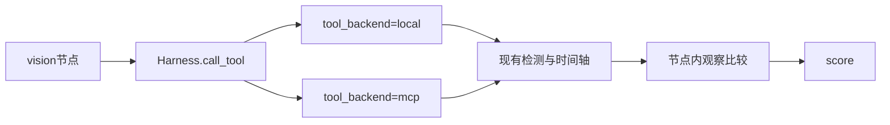

# 12 视觉 MCP

上一阶段是已完成的真实媒体视觉，见 [.cursor/plans/11-real-media-vision.plan.md](.cursor/plans/11-real-media-vision.plan.md)。本文件是阶段 12，落地到 [.cursor/plans/12-vision-mcp.plan.md](.cursor/plans/12-vision-mcp.plan.md)。下一阶段是 [.cursor/plans/13-workorder-mcp.plan.md](.cursor/plans/13-workorder-mcp.plan.md)。延续 [docs/vehicle-risk-agent-implementation-plan.md](docs/vehicle-risk-agent-implementation-plan.md) 第 14.1 节的 `vision-mcp`，以及阶段 07 的「节点只经 Harness 调工具」。目标跟踪、检测可视化、事件入库、批量推理、OpenCV、RTSP、循环视频流、工单、Skill、Kafka 和前端仍不纳入。`get_visual_analysis` 留到事件入库之后。

本阶段只证明一件事：研判里的图片检测和短视频聚合可以走 MCP `tools/call`，入参出参与现在的检测框、时间戳和关键帧一致，且不改变「代码评分、模型不能改风险分」。没有图片、没有视频的报警不调用这两个工具，分数和状态与阶段 11 一致。

## 流程

研判图仍是 `validate → context → history → retrieve → graph → vision → score → report/review`。不新增节点。画面观察比较、`vlm` 读图和 `compare_observation` 留在 [src/vehicle_agent/graph/nodes.py](src/vehicle_agent/graph/nodes.py)。不把视觉大模型放进 MCP 工具，避免模型调用绕过当前 Harness 预算。`prompt_version` 保持 `report-v6`。

## 工具

在 [src/vehicle_agent/harness/tools.py](src/vehicle_agent/harness/tools.py) 增加两个只读工具，角色仍是 `monitor`，可以安全重试。handler 调用已经打开的 `VisionIndex` 和 `VideoTimeline`，不复制检测或聚合逻辑。

- `analyze_image`：入参 `image_id`。出参 `detections`。`vision_backend=fixture` 时只按 id 查定样本。`vision_backend=yolo` 时由 handler 调用现有 `read_stored_image`，再 `analyze(image_id, content)`。空文件或缺文件由 handler 抛错。未知 id 返回空列表，不是异常。
- `analyze_video`：入参 `video_id` 和 `speed_kmh`。出参沿用现有 `VideoOutcome` 的帧、事件和遮挡。fixture 时间轴继续忽略文件字节。`video_backend=ffmpeg` 时仍由时间轴读取已保存视频。未知 `video_id` 返回空帧，不是异常。

[src/vehicle_agent/api/main.py](src/vehicle_agent/api/main.py) 的上传接口继续直接调用同一个检测器和时间轴，不绕 MCP。`build_vehicle_tools`、`open_registered_tools` 和 [src/vehicle_agent/mcp/server.py](src/vehicle_agent/mcp/server.py) 的 `serve_stdio` 接收这对已经打开的视觉依赖。stdio 子进程按配置自己打开它们。

## 研判节点

`vision` 节点改为 `harness.call_tool`。无 `image_id` 且无 `video_id` 时不调用工具。两者都有时仍以视频为准，只调用 `analyze_video`。

工具抛错、超时或预算耗尽时，沿用现有降级：`vision_status=degraded`，错误码仍写 `vision_unavailable`，状态为 `awaiting_review`，整单不标为 `failed`。返回空检测或未形成事件时仍是 `vision_status=miss`。命中后的观察比较、冲突和评分规则不改。无图路径的工具预算与现在相同：现有 `max_tool_calls=2` 的法规预算测试不因本阶段多一次调用。

测试里注入的检测器和时间轴要进入 Harness 使用的注册表。[tests/test_graph.py](tests/test_graph.py) 的 `_run` 把 `vision` 和 `video` 传给 `build_vehicle_tools`，节点不再另持一份检测器。

## 验收

- 定样本：阶段 08 至 11 的无图、闭眼、遮挡、不一致、连续命中、单帧、缺文件和降级测试保持通过，`risk_score` 不变。无图研判的 trace 不含 `analyze_image` 或 `analyze_video`。
- 本地工具：带 `image_closed_eye` 的高速报警仍为 `completed`，`risk_score == 1.0`，证据含检测框和「画面观察支持 closed_eye」。`video_fatigue` 仍含起止时间和关键帧时间戳。
- 契约：内存传输的 `tools/list` 含原来四个工具加 `analyze_image`、`analyze_video`。入参 Schema 与 Pydantic 模型一致，且为只读、可重试。`analyze_image` 对 `image_closed_eye` 的返回与本地 handler 相同。未知工具和角色不符仍分别是工具错误和 `PolicyDeniedError`。
- MCP 研判：`tool_backend=mcp` 且内存传输时，同一张闭眼图片的 `risk_score`、状态和可见事实与 `local` 相同。检测器抛错时 `vision_status=degraded`，进入复核，整单不标为 `failed`；`max_retries=1` 时 `analyze_image` 被调用两次。
- 模型预算：有图研判的模型调用仍只发生在 `report`，以及 `review_backend=vlm` 时的那一次视觉模型调用。

更新 [README.md](README.md)：六个只读工具；视觉分析在 `tool_backend=mcp` 时走 MCP，默认仍是进程内 handler。把阶段 11 计划中的下一阶段指向本文件。

## 仍留到后续

- `get_visual_analysis`、检测结果可视化和事件入库。
- 目标跟踪、批量推理、OpenCV、RTSP 和循环视频流。
- 工单、Skill、Kafka 和前端。

测试通过后按仓库规则提交一次中文 commit。阶段 12 的计划只保留本文件。
