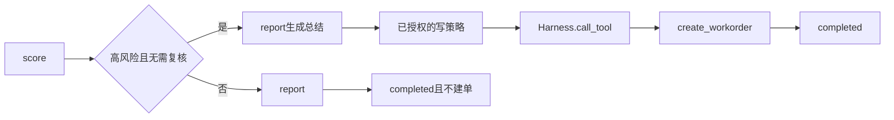

# 13 工单 MCP

上一阶段是已完成的视觉 MCP，见 [.cursor/plans/12-vision-mcp.plan.md](.cursor/plans/12-vision-mcp.plan.md)。本文件是阶段 13，落地到 [.cursor/plans/13-workorder-mcp.plan.md](.cursor/plans/13-workorder-mcp.plan.md)。下一阶段再写 `.cursor/plans/14-alarm-verification-skill.plan.md`，本阶段不创建该文件。延续 [docs/vehicle-risk-agent-implementation-plan.md](docs/vehicle-risk-agent-implementation-plan.md) 第 14.1 节的 `workorder-mcp`，以及第 7.3 节「创建工单等写操作需要显式授权」。`get_visual_analysis`、事件入库、目标跟踪、批量推理、OpenCV、RTSP、循环视频流、Skill、Kafka 和前端仍不纳入。

本阶段只证明一件事：代码可以在高风险且不需要人工复核的研判完成后创建一张工单，调用经 Harness，模型不能改风险分，也不能决定是否建单。中风险、低风险、人工复核和复核之后的报告都不建单。`risk_score`、复核条件和 `prompt_version`（`report-v6`）不变。

## 流程

研判图仍是 `validate → context → history → retrieve → graph → vision → score → report/review`。不新增节点。建单发生在 [src/vehicle_agent/graph/nodes.py](src/vehicle_agent/graph/nodes.py) 的 `report` 里，且在 `complete_structured` 成功之后。模型消息不增加工单字段，模型看不到这个工具。

## 仓储与工具

新增进程内 `MemoryWorkOrderStore`。同一 `task_id` 只保留一张工单，标识为 `wo-{task_id}`。再次创建返回原工单，不新增记录。stdio 子进程有自己的空仓储；本阶段不引入数据库。验收使用现有内存 MCP 传输，父子进程共享同一个仓储对象。

在 [src/vehicle_agent/harness/tools.py](src/vehicle_agent/harness/tools.py) 增加三个工具。`build_vehicle_tools`、[src/vehicle_agent/mcp/client.py](src/vehicle_agent/mcp/client.py) 的 `open_registered_tools` 和 [src/vehicle_agent/mcp/server.py](src/vehicle_agent/mcp/server.py) 的 `serve_stdio` 接收已经打开的仓储。

- `create_workorder`：入参 `task_id`、`alarm_id`、`risk_level`、`summary`。`readonly=False`，角色仍是 `monitor`，幂等。`risk_level` 不是 `high` 时抛错。出参是工单标识、状态 `open` 和上述字段。
- `get_workorder`：入参 `workorder_id`。只读。未知标识抛错，不返回空对象。
- `update_workorder`：入参 `workorder_id`、`status`、`comment`。`readonly=False`。未知标识抛错。研判节点不调用它。

[src/vehicle_agent/mcp/server.py](src/vehicle_agent/mcp/server.py) 的工具注解改为按 `readonly` 填写 `read_only_hint`。三个工单工具里只有 `get_workorder` 为只读。`idempotent_hint` 对创建和更新都为真，因为创建按 `task_id` 去重，更新是覆盖状态和备注。

## 授权与研判

[src/vehicle_agent/harness/policy.py](src/vehicle_agent/harness/policy.py) 的 `AllowReadOnlyPolicy` 继续拒绝任意写工具。新增只放行 `create_workorder` 的策略。现有「未授权写工具被拒绝」测试保持通过。

[src/vehicle_agent/api/main.py](src/vehicle_agent/api/main.py) 和会跑完整研判的测试 Harness 使用该策略。策略拒绝、工具抛错、超时或预算耗尽时，`report` 仍返回已生成的 `result`，状态保持 `completed`，另记 `workorder_status=degraded` 和错误码 `workorder_unavailable`，整单不标为 `failed`。

只在 `risk_level=high` 且 `requires_human_review` 为假时调用 `create_workorder`。节点传入的 `summary` 是刚刚生成的报告摘要。中风险完成路径不调用。进入 `review` 的路径，以及复核后回到 `report` 的路径，都不调用。无图且在 `retrieve` 之前耗尽工具预算的现有测试不因本阶段多一次调用。默认 `max_tool_calls=8` 足够覆盖高风险路径上的这一次创建。

## 接口

上传和视觉接口仍不绕 MCP。工单接口直接使用同一个仓储：

- `POST /api/v1/workorders`：与创建工具相同的校验和幂等规则。
- `GET /api/v1/workorders/{workorder_id}`：未知标识返回 404。
- `PATCH /api/v1/workorders/{workorder_id}`：覆盖状态和备注。

`TaskView` 在已建单时带上 `workorder_id`。

## 验收

- 定样本：阶段 08 至 12 的无图、闭眼、遮挡、不一致、连续命中、单帧、缺文件、降级和 MCP 一致性测试保持通过，`risk_score` 不变。中风险完成研判的 trace 不含 `create_workorder`。
- 高风险：车速、法规和图谱都命中的完成研判仍为 `completed`，`risk_score == 1.0`，并得到 `wo-{task_id}`。同一 `task_id` 再创建一次仍是这一张。人工复核路径和复核后的报告没有工单。
- 失败：创建工具抛错时结果仍在，状态为 `completed`，`workorder_status=degraded`，整单不标为 `failed`。默认只读策略下直接调用 `create_workorder` 仍是 `PolicyDeniedError`。
- 契约：内存传输的 `tools/list` 含原来六个工具加这三个。只读工具的 `read_only_hint` 仍为真；创建和更新为假。入参 Schema 与 Pydantic 模型一致。未知工具和角色不符仍分别是工具错误和 `PolicyDeniedError`。
- MCP 研判：`tool_backend=mcp` 且内存传输时，同一条高风险报警的 `risk_score`、状态和工单标识与 `local` 相同。模型调用仍只发生在 `report`，以及 `review_backend=vlm` 时的那一次视觉模型调用。

更新 [README.md](README.md)：九个工具；六个只读工具保持可重试；工单创建是经授权的写操作，只在高风险且无需复核时发生。删掉「本阶段不包含视觉 MCP、工单 MCP」这句过时边界。把阶段 12 计划中的下一阶段指向本文件。

## 仍留到后续

- `get_visual_analysis`、检测结果可视化和事件入库。
- 目标跟踪、批量推理、OpenCV、RTSP 和循环视频流。
- Skill、Kafka、工单数据库和前端。

测试通过后按仓库规则提交一次中文 commit。阶段 13 的计划只保留本文件。
