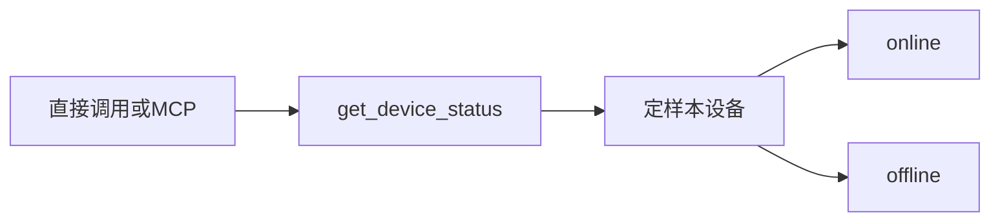

# 15 设备在线状态

上一阶段是已完成的报警核验 Skill，见 [.cursor/plans/14-alarm-verification-skill.plan.md](.cursor/plans/14-alarm-verification-skill.plan.md)。本文件是阶段 15，落地到 [.cursor/plans/15-device-online-status.plan.md](.cursor/plans/15-device-online-status.plan.md)。下一阶段再写 `.cursor/plans/16-device-diagnosis-skill.plan.md`，本阶段不创建该文件。延续 [docs/vehicle-risk-agent-implementation-plan.md](docs/vehicle-risk-agent-implementation-plan.md) 第 11.1 节的 Device，以及第 14.1 节 `vehicle-mcp` 里的 `get_device_status`。固件库、维修记录、设备诊断 Skill、Kafka 和前端仍不纳入。

本阶段只证明一件事：定样本设备可以读出在线或离线，以及最后心跳时间。读取经只读工具，可以安全重试。疲劳驾驶研判图不调用这个工具，`alarm-verification` 的六个工具不变。`risk_score`、复核条件、是否建单和 `prompt_version`（`report-v6`）不变。

## 流程

研判图仍是 `validate → context → history → retrieve → graph → vision → score → report/review`。不新增节点。`context` 仍只调用 `get_vehicle_context`。

## 定样本

在 [src/vehicle_agent/domain/models.py](src/vehicle_agent/domain/models.py) 增加 `Device`。字段是 `id`、`online_status`（`online` 或 `offline`）和 `last_heartbeat_at`。不放固件版本、序列号和型号。

[src/vehicle_agent/repositories/memory.py](src/vehicle_agent/repositories/memory.py) 的种子与现有三台车对齐，心跳的「现在」仍是 `2026-10-09T10:30:00Z`：

- `device_001`、`device_002`：`online`，心跳就是这个时间。
- `device_003`：`offline`，心跳是两天前。这台设备图谱里已有 `camera_occlusion`，留给下一阶段区分遮挡和离线。

未知 `device_id` 抛错，不返回空对象。另留 `device_error`，读取时抛出连接错误，供工具失败测试使用。车辆查询的 `vehicle_error` 行为不变。

## 工具

在 [src/vehicle_agent/harness/tools.py](src/vehicle_agent/harness/tools.py) 增加只读工具 `get_device_status`。入参 `device_id`。出参是上面的 `Device`。角色仍是 `monitor`，`readonly=True`。handler 只读仓储，不复制一份设备表。

[src/vehicle_agent/mcp/server.py](src/vehicle_agent/mcp/server.py) 继续使用 `build_vehicle_tools`，因此 stdio 和内存传输自动带上这个工具。不新增 HTTP 接口。

[src/vehicle_agent/skills/alarm_verification.py](src/vehicle_agent/skills/alarm_verification.py) 的工具列表不加入 `get_device_status`。编译图时的核对仍然只要求那六个只读工具已注册。

## 验收

- 定样本：`device_001` 为 `online`，心跳是 `2026-10-09T10:30:00Z`。`device_003` 为 `offline`，心跳早两天。未知标识和 `device_error` 都是工具错误。
- 研判：阶段 08 至 14 的无图、有图、遮挡、不一致、连续命中和降级测试保持通过，`risk_score` 不变。高速无图研判的 trace 仍是四个查询工具，不含 `get_device_status`。`alarm-verification` 的工具列表仍是原来六个。
- 契约：[tests/test_mcp.py](tests/test_mcp.py) 的 `TOOL_NAMES` 加上 `get_device_status`。内存传输的 `tools/list` 含这十个工具。该工具的入参 Schema 与 Pydantic 模型一致，且为只读、可重试。本地 handler 与 MCP 对 `device_003` 的返回相同。

更新 [README.md](README.md)：十个工具；七个只读工具可以安全重试，其中包含 `get_device_status`。研判图不查询在线状态。把阶段 14 计划里的下一阶段从 `15-device-diagnosis-skill.plan.md` 指向本文件。

测试通过后按仓库规则提交一次中文 commit。阶段 15 的计划只保留本文件。
