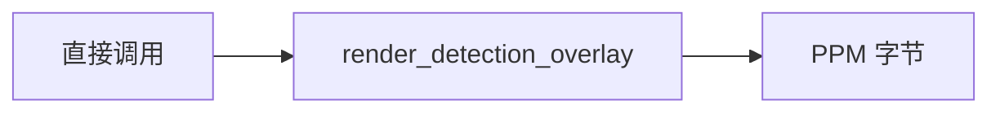

# 24 检测可视化

上一阶段是已完成的运营报告，见 [.cursor/plans/23-operation-report.plan.md](.cursor/plans/23-operation-report.plan.md)。本文件是阶段 24，落地到 [.cursor/plans/24-detection-visualization.plan.md](.cursor/plans/24-detection-visualization.plan.md)。下一阶段是 [.cursor/plans/25-object-tracking.plan.md](.cursor/plans/25-object-tracking.plan.md)。RTSP 排在目标跟踪之后，本阶段也不创建那个计划。延续 [docs/vehicle-risk-agent-implementation-plan.md](docs/vehicle-risk-agent-implementation-plan.md) 第 7 周里尚未落地的检测结果可视化。驾驶员汇总、企业汇总、路线偏离、独立的超速报警类型、目标跟踪、RTSP、Kafka 和前端仍不纳入。

本阶段只证明一件事：给定现有检测框，代码可以在 100×100 的黑底上画出一像素宽的白框，并返回这张图的字节。画布尺寸固定，不读取、不解码已保存的图片。`image_closed_eye` 的框仍是 [0.4, 0.2, 0.62, 0.55]，类别和置信度不变。模型不参与。疲劳驾驶研判图不调用这次绘制。`risk_score`、复核条件、是否建单和 `prompt_version`（`report-v6`）不变。不新增工具，不新增 HTTP 接口。工具数仍是十一个。不安装 OpenCV、Pillow 或 ultralytics。默认测试不解码像素。

## 流程

疲劳驾驶研判图仍是 `validate → context → history → retrieve → graph → vision → score → report/review`。上传图片接口仍只保存原字节并返回检测框。

## 绘制

函数放在 [src/vehicle_agent/knowledge/vision.py](src/vehicle_agent/knowledge/vision.py)，名为 `render_detection_overlay`。入参是 `list[Detection]`。宽和高固定为 100。任一小于 1 时抛出 `ValueError`，不返回字节。

归一化坐标换成像素：`int(value * side + 1e-6)`。左、上包含，右、下不包含。`image_closed_eye` 因此是左 40、上 20、右 62、下 55。右不大于左，或下不大于上时，这个框不画。框边是该矩形最外一圈像素，框内保持黑色。没有检测框时整张图都是黑色。

输出是 PPM P6：头是 `P6\n100 100\n255\n`，随后每个像素 3 字节。背景是 0,0,0，框边是 255,255,255。多个框都画上去，后画的边可以盖住先画的内部。

## 定样本

不改 [src/vehicle_agent/knowledge/vision_fixtures/catalog.json](src/vehicle_agent/knowledge/vision_fixtures/catalog.json)，也不改报警、车速、维修和图谱。

- `image_closed_eye` 的现有检测：点 (40, 20) 和 (61, 54) 是白色，点 (50, 30) 是黑色。
- `image_empty` 的空检测：没有任何白色像素。
- 测试自行构造一个右不大于左的框，确认它不产生白色像素。

## 验收

- `image_closed_eye` 的叠加图含有上述白边，头三个像素仍是黑色背景的开头。
- 空检测图的像素全黑，尺寸仍是 100×100。
- 宽或高小于 1 时抛出 `ValueError`。
- 阶段 08 至 23 的疲劳研判保持通过，`risk_score` 不变。上传接口保存的原字节不变。高速无图研判的 trace 仍是原来四个查询工具。
- 不调用模型。不新增工具。

更新 [README.md](README.md)：检测可视化把归一化框画到 100×100 的 PPM 上，不解码原图。`image_closed_eye` 的框边落在左 40、上 20、右 62、下 55。删掉排除项里的「检测可视化」。目标跟踪、RTSP、驾驶员汇总、企业汇总、路线偏离、Kafka 和前端仍排除。把阶段 23 计划里的下一阶段指向本文件。

测试通过后按仓库规则提交一次中文 commit。阶段 24 的计划只保留本文件。Cursor 计划工具若把副本写到用户全局 `~/.cursor/plans/`，生成后立刻以本文件为准，并删除全局副本。
