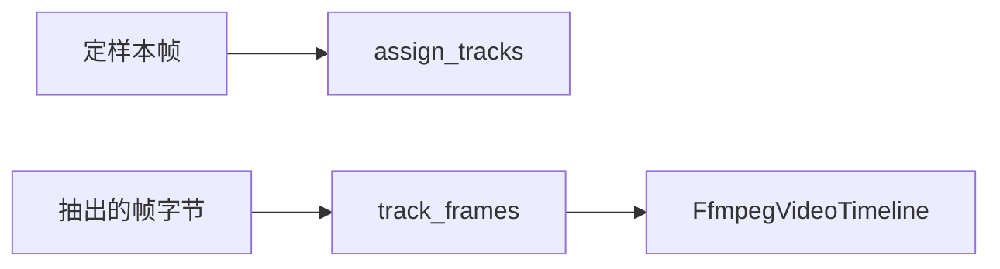

# 25 目标跟踪

上一阶段是已完成的检测可视化，见 [.cursor/plans/24-detection-visualization.plan.md](.cursor/plans/24-detection-visualization.plan.md)。本文件是阶段 25，落地到 [.cursor/plans/25-object-tracking.plan.md](.cursor/plans/25-object-tracking.plan.md)。下一阶段再写 `.cursor/plans/26-rtsp-stream.plan.md`，本阶段不创建该文件。延续 [docs/vehicle-risk-agent-implementation-plan.md](docs/vehicle-risk-agent-implementation-plan.md) 第 16.2 节里可选的目标跟踪。驾驶员汇总、企业汇总、路线偏离、独立的超速报警类型、RTSP、Kafka 和前端仍不纳入。本阶段不单独安装 ByteTrack 或 OpenCV。YOLO 路径使用 Ultralytics 自带的 `model.track`。

本阶段只证明一件事：同一段连续帧里的检测可以带上轨迹编号。定样本没有像素，编号由代码按相邻帧交并比决定。`vision_backend=yolo` 且帧上有图片字节时，编号来自 YOLO 的 `track`，不再自己做交并比。单张图片的 `analyze` 仍调用 `predict`。模型不改编号。不改 [src/vehicle_agent/knowledge/video.py](src/vehicle_agent/knowledge/video.py) 的 `aggregate_frames`，疲劳驾驶研判图也不调用 `assign_tracks`。`risk_score`、复核条件、是否建单和 `prompt_version`（`report-v6`）不变。不新增工具，不新增 HTTP 接口。工具数仍是十一个。默认测试不解码视频，也不加载 YOLO 权重。

## 流程

疲劳驾驶研判图仍是 `validate → context → history → retrieve → graph → vision → score → report/review`。定样本短视频聚合仍只产出原来的事件和关键帧，返回里没有轨迹编号。

## 定样本

函数放在 [src/vehicle_agent/knowledge/video.py](src/vehicle_agent/knowledge/video.py)，名为 `assign_tracks`。入参是 `list[VideoFrame]`。先按 `timestamp_s` 排序，同一时刻保持原有检测顺序。每一帧只和排在它前面的那一帧比较。空帧不保留可接上的轨迹。

同一类别且交并比不低于 0.5 时，沿用上一帧那个框的编号。一帧里多个框都够格时，取得分最高的一个；得分相同则取检测列表里更靠前的那个。没有可接上的框时使用下一个新编号。编号从 1 递增。没有检测框时不产生编号。

`video_fatigue` 的四帧都是 `image_closed_eye` 的同一个框，交并比是 1，轨迹都是 1。不改 [src/vehicle_agent/knowledge/video_fixtures/catalog.json](src/vehicle_agent/knowledge/video_fixtures/catalog.json)。

另两条放在测试里构造，不改定样本：

- 下一帧换成同一位置的 `yawn`：类别不同，轨迹是 2。
- 下一帧换成不相交的框：交并比是 0，轨迹是 2。交并比正好是 0.5 的两个 `closed_eye` 框仍共用轨迹 1。

## YOLO

[src/vehicle_agent/knowledge/vision.py](src/vehicle_agent/knowledge/vision.py) 的 `YoloVisionIndex` 增加 `track_frames`。入参是按时间排列的图片字节。对每一帧调用已加载模型的 `track(..., persist=True)`，读取 `boxes.id` 作为轨迹编号。类别过滤、归一化框和现在的 `analyze` 相同。没有 `id` 的框不产生轨迹。一段帧全部处理完后清空这次跟踪状态，下一段从新的编号开始。

`analyze` 仍只调用 `predict`，不打开 `persist`。上传单张图片的接口因此不带轨迹编号。

[FfmpegVideoTimeline](src/vehicle_agent/knowledge/video.py) 在视觉索引提供 `track_frames` 时，用它的检测框代替逐帧 `analyze` 做现有聚合。`VideoOutcome` 仍不包含轨迹编号。定样本时间轴没有图片字节，不调用 `track_frames`。

默认测试把一个假模型放进 `YoloVisionIndex`，确认每一帧都走 `track` 且 `persist=True`，段落后跟踪状态被清空，`analyze` 仍走 `predict`。不在默认测试中加载权重。`VEHICLE_AGENT_RUN_YOLO=1` 且本机有权重和样图时，另有一次可选验收：同一张样图连续跟踪两帧，编号是整数。这与 [tests/test_yolo_acceptance.py](tests/test_yolo_acceptance.py) 一样，默认跳过。

## 验收

- `video_fatigue` 的四次闭眼检测轨迹都是 1。
- 类别不同或框不相交时新开轨迹。交并比等于 0.5 时仍沿用原轨迹。
- `video_empty` 不产生轨迹编号。
- 假模型上，一段两帧只调用 `track`，并在结束后清空跟踪状态。随后的 `analyze` 调用 `predict`。
- 阶段 08 至 24 的疲劳研判保持通过，`risk_score` 不变。定样本 `analyze_video` 的返回仍没有轨迹编号。高速无图研判的 trace 仍是原来四个查询工具。
- 默认测试不调用真实 YOLO。不新增工具。

更新 [README.md](README.md)：定样本跟踪只比较相邻帧，同一类别且交并比不低于 0.5 时共用轨迹编号。`video_fatigue` 的四帧闭眼是轨迹 1。`vision_backend=yolo` 时，一段抽出的帧走 YOLO 自带的 `track`，单张图片仍走 `predict`。研判图不调用定样本跟踪。删掉排除项里的「目标跟踪」。RTSP、驾驶员汇总、企业汇总、路线偏离、Kafka 和前端仍排除。把阶段 24 计划里的下一阶段指向本文件。

测试通过后按仓库规则提交一次中文 commit。阶段 25 的计划只保留本文件。Cursor 计划工具若把副本写到用户全局 `~/.cursor/plans/`，生成后立刻以本文件为准，并删除全局副本。
