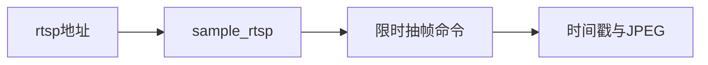

# 26 RTSP 抽帧

上一阶段是已完成的目标跟踪，见 [.cursor/plans/25-object-tracking.plan.md](.cursor/plans/25-object-tracking.plan.md)。本文件是阶段 26，落地到 [.cursor/plans/26-rtsp-stream.plan.md](.cursor/plans/26-rtsp-stream.plan.md)。确认本计划后，把正文写入该路径；若 Cursor 计划工具在用户全局 `~/.cursor/plans/` 留下副本，以仓库内文件为准并删除全局副本。下一阶段本阶段不创建。延续 [docs/vehicle-risk-agent-implementation-plan.md](docs/vehicle-risk-agent-implementation-plan.md) 第 8 周「增加 RTSP 或循环视频流模拟」和第 16.2 节里「视频流 → FFmpeg 解码 → 按策略抽帧」。驾驶员汇总、企业汇总、路线偏离、独立的超速报警类型、JT1078、Kafka 和前端仍不纳入。

本阶段只证明一件事：给定 `rtsp://` 地址，代码拼出一条限时 4 秒、每秒一帧的 FFmpeg 命令，并把抽出的 JPEG 和 `pts_time` 配成与 [ffmpeg_extract_frames](src/vehicle_agent/knowledge/video.py) 相同的 `list[tuple[float, bytes]]`。不启动 RTSP 服务，不监听端口，不把地址写进报警或研判图。模型不参与。`risk_score`、复核条件、是否建单和 `prompt_version`（`report-v6`）不变。不新增工具，不新增 HTTP 接口。工具数仍是十一个。`VideoBackend` 仍是 `fixture` 和 `ffmpeg`。默认测试不调用 FFmpeg，也不打开套接字。

## 流程

疲劳驾驶研判图仍是 `validate → context → history → retrieve → graph → vision → score → report/review`。`FfmpegVideoTimeline` 仍只读已保存的视频文件。`analyze_video` 不接收流地址。

## 抽帧

函数放在 [src/vehicle_agent/knowledge/video.py](src/vehicle_agent/knowledge/video.py)，名为 `sample_rtsp`。入参是地址字符串，以及可选的命令执行器，便于测试替换。地址去掉首尾空白后必须以 `rtsp://` 开头，且后面还有内容；否则抛出 `ValueError`，不调用执行器。`http://`、文件路径和空字符串都拒绝。

命令固定为：

`ffmpeg -hide_banner -rtsp_transport tcp -t 4 -i <url> -vf fps=1,showinfo <临时目录>/frame_%04d.jpg`

`-t 4` 放在 `-i` 之前，限制读取输入的时长。临时目录、按 `pts_time` 与 JPEG 配对、帧数不一致则 `RuntimeError`、没有帧则 `RuntimeError`、找不到 `ffmpeg` 则 `FileNotFoundError("ffmpeg is not installed")`，与现有 `ffmpeg_extract_frames` 相同。文件抽帧的参数不变：仍是 `-i` 本地路径，没有 `-rtsp_transport`，也没有 `-t 4`。

可以把两者共用的「跑命令、读 stderr 时间戳、读 JPEG」收成一个内部函数。`ffmpeg_extract_frames` 的对外行为和现有测试保持不变。

## 验收

- `rtsp://camera/live` 在假执行器上只调用一次，参数含 `-rtsp_transport`、`tcp`、`-t`、`4`，且 `-t` 出现在 `-i` 之前；返回的两帧时间戳和字节与执行器给出的一致。
- 空字符串、空白、`http://camera/live` 和本地路径抛出 `ValueError`，执行器不被调用。
- 执行器报告找不到 ffmpeg 时，异常信息仍是 `ffmpeg is not installed`。没有帧或时间戳数量与图片数量不一致时抛出 `RuntimeError`。
- 阶段 08 至 25 的疲劳研判保持通过，`risk_score` 不变。`video_backend` 仍不能取 `rtsp`。高速无图研判的 trace 仍是原来四个查询工具。
- 默认测试不调用真实 FFmpeg，也不连接 RTSP。不新增工具。

更新 [README.md](README.md)：RTSP 抽帧只接受 `rtsp://` 地址，用 TCP 读取最多 4 秒，每秒一帧，返回时间戳和 JPEG。研判图不调用它。删掉排除项里的「RTSP」。驾驶员汇总、企业汇总、路线偏离、神经网络 Embedding、Kafka 和前端仍排除。把阶段 25 计划里的下一阶段指向本文件。

测试通过后按仓库规则提交一次中文 commit。阶段 26 的计划只保留仓库内的 `.cursor/plans/26-rtsp-stream.plan.md`。
