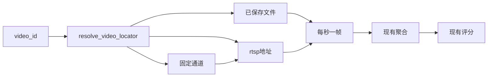

# 28 统一视频入口

上一阶段是已完成的报警事件，见 [.cursor/plans/27-vehicle-alarm-event.plan.md](.cursor/plans/27-vehicle-alarm-event.plan.md)。本文件是阶段 28，落地到 [.cursor/plans/28-video-source.plan.md](.cursor/plans/28-video-source.plan.md)。确认本计划后，把正文写入该路径；若 Cursor 计划工具在用户全局 `~/.cursor/plans/` 留下副本，以仓库内文件为准并删除全局副本。下一阶段本阶段不创建。延续 [docs/vehicle-risk-agent-implementation-plan.md](docs/vehicle-risk-agent-implementation-plan.md) 第 3.2 节的统一视频适配接口和简化 JT1078 适配器。驾驶员汇总、企业汇总、路线偏离、独立的超速报警类型、手机使用研判、神经网络 Embedding、Kafka 经纪人及其余主题和前端仍不纳入。

本阶段只证明一件事：`video_id` 可以是已保存的文件名、`rtsp://` 地址，或唯一一条 `jt1078://013800138000/1`。后两种都交给现有的 [sample_rtsp](src/vehicle_agent/knowledge/video.py)，再走现有连续帧聚合。研判图的节点不改，仍然调用 `analyze_video`。默认 `video_backend=fixture` 仍只读定样本目录，不调用 FFmpeg，也不打开套接字。模型不参与。`risk_score` 的计算公式、复核条件和 `prompt_version`（`report-v6`）不变。不新增工具，不新增 HTTP 接口。工具数仍是十一个。不解析 JT1078 的 RTP 或 PS，不监听端口。

## 流程

疲劳驾驶研判图仍是 `validate → context → history → retrieve → graph → vision → score → report/review`。

## 定位

函数放在 [src/vehicle_agent/knowledge/video.py](src/vehicle_agent/knowledge/video.py)，名为 `resolve_video_locator`。先去掉首尾空白。

- 以 `rtsp://` 开头且后面还有内容：种类是 `rtsp`，抽帧地址就是它自己。只有 `rtsp://` 时抛出 `ValueError`。
- 以 `jt1078://` 开头：只接受 `jt1078://013800138000/1`。它对应 `rtsp://camera/live`。其他 SIM 或通道抛出 `ValueError`，不调用抽帧。
- 其余必须是单个文件名，规则与 [image_file](src/vehicle_agent/knowledge/vision.py) 相同。种类是 `file`。

[FfmpegVideoTimeline](src/vehicle_agent/knowledge/video.py) 增加可选的流抽帧函数，默认是 `sample_rtsp`。`analyze` 先解析定位。文件仍用现在的 `ffmpeg_extract_frames` 读已保存视频。`rtsp` 和这条 JT1078 都把解析出的 RTSP 地址交给流抽帧，不再调用 `read_stored_video`。抽到的帧仍走现有检测或 `track_frames`，再交给 `aggregate_frames`。

保存用的图片标识：非字母和数字换成下划线，连续下划线并成一个，去掉首尾下划线，再加 `__` 和帧序号。因此 `clip` 仍是 `clip__0`，`rtsp://camera/live` 的第一帧是 `rtsp_camera_live__0`，这条 JT1078 的第一帧是 `jt1078_013800138000_1__0`。文件抽帧命令和 RTSP 命令的参数都不改。

## 研判

默认定样本时间轴不解析这三种定位。`video_backend=ffmpeg` 时，现有 `vision` 节点把报警里的 `video_id` 原样送进 `analyze_video`，从而走上上面的入口。测试自行构造时间轴：流抽帧返回与 `video_fatigue` 相同的 0、1、2、3 秒四帧，检测都是 `closed_eye`，观察标签也支持 `closed_eye`。报警使用 `vehicle_001`、车速 85、`video_id` 为 `jt1078://013800138000/1`。

## 验收

- `jt1078://013800138000/1` 解析成 `rtsp://camera/live`。假抽帧只被调用一次，参数就是这个地址；文件抽帧不被调用。四帧闭眼聚合成 0 到 3 秒的事件，第一帧标识是 `jt1078_013800138000_1__0`。
- 直接使用 `rtsp://camera/live` 时，抽帧地址相同，第一帧标识是 `rtsp_camera_live__0`。
- 未知的 `jt1078://999/1`、单独的 `rtsp://` 抛出 `ValueError`，抽帧函数不被调用。
- 文件名 `clip` 仍只走文件抽帧，帧标识仍是 `clip__0`。
- 上述 JT1078 报警走研判后，`risk_score` 是 1.0，证据里有 `时段 0.00s-3.00s` 和 `关键帧 0.00s`。阶段 08 至 27 的定样本疲劳研判保持通过。高速无图研判的 trace 仍是原来四个查询工具。
- 默认测试不调用真实 FFmpeg，也不连接 RTSP。不新增工具。

更新 [README.md](README.md)：`video_backend=ffmpeg` 时，已保存文件、`rtsp://` 和 `jt1078://013800138000/1` 走同一个抽帧入口；这条 JT1078 只映射到 `rtsp://camera/live`，不解析码流。默认定样本时间轴不变。驾驶员汇总、企业汇总、路线偏离、神经网络 Embedding、Kafka 经纪人及其余主题和前端仍排除。把阶段 27 计划里的下一阶段指向本文件。

测试通过后按仓库规则提交一次中文 commit。阶段 28 的计划只保留仓库内的 `.cursor/plans/28-video-source.plan.md`。
