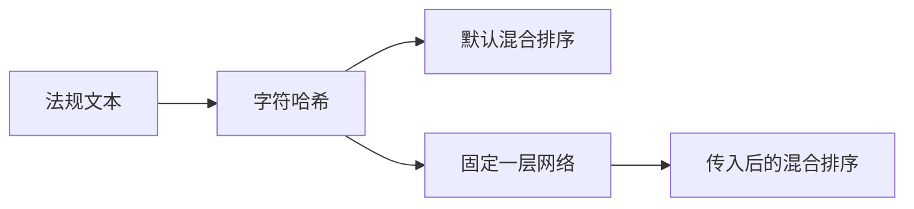

# 29 神经网络向量

上一阶段是已完成的统一视频入口，见 [.cursor/plans/28-video-source.plan.md](.cursor/plans/28-video-source.plan.md)。本文件是阶段 29，落地到 [.cursor/plans/29-neural-embedding.plan.md](.cursor/plans/29-neural-embedding.plan.md)。确认本计划后，把正文写入该路径；若 Cursor 计划工具在用户全局 `~/.cursor/plans/` 留下副本，以仓库内文件为准并删除全局副本。下一阶段本阶段不创建。延续 [docs/vehicle-risk-agent-implementation-plan.md](docs/vehicle-risk-agent-implementation-plan.md) 第 15.3 节的向量检索。驾驶员汇总、企业汇总、路线偏离、独立的超速报警类型、手机使用研判、Kafka 经纪人及其余主题和前端仍不纳入。

本阶段只证明一件事：同一段文本可以先变成现在的 128 维字符哈希，再经过一层固定权重的线性变换和 `tanh`，得到另一个 128 维单位向量。默认的 [hybrid_rank](src/vehicle_agent/knowledge/hybrid.py) 仍调用 [regulation_vector](src/vehicle_agent/knowledge/hybrid.py)。只有调用方传入向量函数时，查询和摘录的向量才来自这个函数；关键词重叠、RRF 和加权重排不变。研判图不传入向量函数。Qdrant 仍写入并查询字符哈希，避免两种向量放进同一个集合。不下载模型，不增加依赖。`risk_score`、复核条件和 `prompt_version`（`report-v6`）不变。不新增工具。工具数仍是十一个。

## 流程

疲劳驾驶研判图仍是 `validate → context → history → retrieve → graph → vision → score → report/review`。

## 向量

函数放在 [src/vehicle_agent/knowledge/hybrid.py](src/vehicle_agent/knowledge/hybrid.py)，名为 `neural_embed`。先调用 `regulation_vector`。第 `i` 行第 `j` 列的权重是 `sha256(f"w:{i}:{j}")` 首字节除以 127.5 再减 1，偏置用 `sha256(f"b:{i}")` 的同样算法。输出先做 `tanh`，再按 `regulation_vector` 的方式做 L2 归一化。全零输入经过偏置后仍归一化。权重第一次使用时算好并留下，后面复用。维度仍是 `VECTOR_SIZE`，也就是 128。

`hybrid_rank` 增加可选参数 `embedder`。缺省时查询和摘录都用 `regulation_vector`。传入时每个文本只调用它一次，不再调用 `regulation_vector`。返回向量的长度必须和查询向量一致，且至少为 1；否则抛出 `ValueError`，不返回排序。

[MarkdownRegulationIndex.search](src/vehicle_agent/knowledge/index.py) 增加同样的可选参数，并交给 `hybrid_rank`。不传时行为与现在相同。`QdrantRegulationIndex` 不接受这个参数，集合里的向量仍由 `regulation_vector` 生成。

## 验收

- `neural_embed` 对「行驶中疲劳驾驶报警应就近停车休息」返回 128 维，两次调用完全相同，并且不等于 `regulation_vector` 的结果。向量长度是 1。
- 默认 `search("driver_fatigue")` 的第一条仍是 `fatigue-rules` 的「第2节 行驶中的报警」。
- 一个假向量函数把摘录 B 排到摘录 A 前面时，`hybrid_rank` 的第一条是 B，而且没有调用 `regulation_vector`。
- 假向量函数返回空向量，或与查询向量长度不同，抛出 `ValueError`。
- 阶段 08 至 28 的疲劳研判保持通过，`risk_score` 不变。Qdrant 假客户端里保存的向量仍等于 `regulation_vector`。高速无图研判的 trace 仍是原来四个查询工具。
- 不下载模型。不新增工具。

更新 [README.md](README.md)：默认法规检索仍是字符二元组哈希。`neural_embed` 在该哈希上加一层固定线性变换和 `tanh`，维度仍是 128。研判和 Qdrant 不使用它。删掉排除项里的「神经网络 Embedding」。驾驶员汇总、企业汇总、路线偏离、Kafka 经纪人及其余主题和前端仍排除。把阶段 28 计划里的下一阶段指向本文件。

测试通过后按仓库规则提交一次中文 commit。阶段 29 的计划只保留仓库内的 `.cursor/plans/29-neural-embedding.plan.md`。
