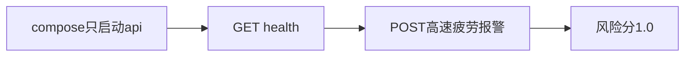

# 34 lite 容器部署

上一阶段是已完成的报警事件研判，见 [.cursor/plans/33-alarm-event-judgement.plan.md](.cursor/plans/33-alarm-event-judgement.plan.md)。本文件是阶段 34，落地到 [.cursor/plans/34-lite-compose.plan.md](.cursor/plans/34-lite-compose.plan.md)。确认本计划后，把正文写入该路径；若 Cursor 计划工具在用户全局 `~/.cursor/plans/` 留下副本，以仓库内文件为准并删除全局副本。下一阶段本阶段不创建。延续 [docs/vehicle-risk-agent-implementation-plan.md](docs/vehicle-risk-agent-implementation-plan.md) 第 25.1 节的 lite 档和第 28 节第 12 条「Docker Compose 可以启动演示环境」。`device.status` 触发诊断、`vehicle.location`、`media.ready`、`judgement.requested`、`judgement.completed`、`workorder.created`、手机使用、独立超速类型、驾驶员汇总、企业汇总、路线偏离、Redis、MinIO、StarRocks、Kubernetes、CI 和前端仍不纳入。

本阶段只证明一件事：`docker compose up -d api` 拉起 API 后，不启动 Neo4j、Qdrant、Kafka，也不需要 GPU 或在线模型，就能提交演示脚本里那条高速疲劳报警，并得到与现有规则相同的风险分 `1.0`。图谱、法规、视觉、视频和画面复核保持默认：`memory`、`markdown`、`fixture`。模型只写总结，不改分数。不新增研判工具。工具数仍是十一个。`prompt_version` 仍是 `report-v6`。

## 流程

疲劳驾驶研判图仍是 `validate → context → history → retrieve → graph → vision → score → report/review`。容器不连接经纪人，也不把 Neo4j、Qdrant 放进这条启动链。

## 进程

在 [src/vehicle_agent/config.py](src/vehicle_agent/config.py) 增加：

- `model_backend`：`openai` 或 `fixture`，默认 `openai`。环境变量是 `VEHICLE_AGENT_MODEL_BACKEND`。
- `host`：默认 `127.0.0.1`。环境变量是 `VEHICLE_AGENT_HOST`。
- `port`：默认 `8000`。环境变量是 `VEHICLE_AGENT_PORT`。

[src/vehicle_agent/api/main.py](src/vehicle_agent/api/main.py) 的 `build_default_app()` 在 `fixture` 时使用 [FakeModelAdapter](src/vehicle_agent/harness/model.py)，总结与 [scripts/demo.py](scripts/demo.py) 相同。`openai` 仍使用 `OpenAICompatibleModel`。`main()` 按 `host` 和 `port` 监听。本机直接启动时默认仍是 `127.0.0.1` 和在线模型。

增加 `GET /health`。它只返回 `{"status":"ok"}`，不调用模型，不打开 Neo4j、Qdrant 或 Kafka。

## 容器

在 [deployments/Dockerfile](deployments/Dockerfile) 用 Python 3.12 slim 和 uv 安装本项目。构建上下文是仓库根目录，法规摘录和定样本随 wheel 带入。不复制 `D:\uv_venv`，不安装 `vision` 可选依赖，不放入 YOLO 权重。

在 [deployments/docker-compose.yml](deployments/docker-compose.yml) 增加 `api` 服务，不设置 `depends_on`。宿主机端口 `8000`。环境变量：

- `VEHICLE_AGENT_MODEL_BACKEND=fixture`
- `VEHICLE_AGENT_HOST=0.0.0.0`
- `VEHICLE_AGENT_CHECKPOINT_PATH=/data/checkpoints.sqlite`

检查点目录用命名卷。健康检查请求 `GET /health`。启动命令仍是按服务名：`docker compose -f deployments/docker-compose.yml up -d api`。Neo4j、Qdrant、Kafka 的单独启动方式不变。

## 验收

默认测试用进程内 `TestClient`，不构建镜像：

- `model_backend=fixture` 时，提交与演示脚本相同的报警：`vehicle_001`、车速 `85`、置信度 `0.9`、没有图片和视频。`risk_score` 是 `1.0`，`risk_level` 是 `high`，状态是 `completed`，`requires_human_review` 是假，并按原规则创建工单。
- `GET /health` 返回 `ok`。默认 `model_backend` 仍是 `openai`，`host` 仍是 `127.0.0.1`。
- 阶段 08 至 33 的既有疲劳研判保持通过。`device.status` 仍不触发诊断。

`tests/test_compose_acceptance.py` 只在 `VEHICLE_AGENT_RUN_COMPOSE=1` 时运行，写法对齐 [tests/test_kafka_acceptance.py](tests/test_kafka_acceptance.py)。它构建并启动 `api`，请求健康检查，再提交上面那条报警，风险分仍是 `1.0`。未设置该变量时整文件跳过。实现时若本机 Docker 可用，跑这一条；不可用则保持跳过，并在交付说明里写明原因。

更新 [README.md](README.md)：lite 容器用 `docker compose -f deployments/docker-compose.yml up -d api` 启动。它使用定样本和固定模型输出，不启动 Neo4j、Qdrant、Kafka，也不调用在线模型。这条报警的风险分是 `1.0`。本机 `python -m vehicle_agent.api.main` 仍默认连接 `VEHICLE_AGENT_MODEL_BASE_URL`。排除项里删掉「不能用 Compose 启动 API」这类说法；驾驶员汇总、企业汇总、路线偏离、`vehicle.location`、`media.ready`、`judgement.requested`、`judgement.completed`、`workorder.created`、Kubernetes 和前端仍排除。把阶段 33 计划里的下一阶段指向本文件。

测试通过后按仓库规则提交一次中文 commit。阶段 34 的计划只保留仓库内的 `.cursor/plans/34-lite-compose.plan.md`。
