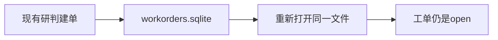

# 36 工单落盘

上一阶段是已完成的报警消费研判，见 [.cursor/plans/35-kafka-alarm-ingest.plan.md](.cursor/plans/35-kafka-alarm-ingest.plan.md)。本文件是阶段 36，落地到 [.cursor/plans/36-workorder-sqlite.plan.md](.cursor/plans/36-workorder-sqlite.plan.md)。确认本计划后，把正文写入该路径；若 Cursor 计划工具在用户全局 `~/.cursor/plans/` 留下副本，以仓库内文件为准并删除全局副本。下一阶段本阶段不创建。延续 [docs/vehicle-risk-agent-implementation-plan.md](docs/vehicle-risk-agent-implementation-plan.md) 第 7.2 节里工单闭环可追溯。在线模型切换、冒烟流水线、`device.status` 触发诊断、`vehicle.location`、`media.ready`、`judgement.requested`、`judgement.completed`、`workorder.created`、手机使用、独立超速类型、驾驶员汇总、企业汇总、路线偏离、Redis、MinIO、StarRocks、Kubernetes、CI 和前端仍不纳入。

本阶段只证明一件事：`fatigue_alarm_event()` 走现有研判图并建单后，关掉进程再打开同一个文件，`wo-evt_20261009_000001` 仍在，状态仍是 `open`。同一个 `task_id` 再创建一次，返回原来的工单。图仍是 `validate → context → history → retrieve → graph → vision → score → report/review`。模型只写总结，不改分数。不新增工具，不新增 HTTP 路径。工具数仍是十一个。`prompt_version` 仍是 `report-v6`。风险分仍是 `0.95`。默认测试不连接 Kafka。

## 流程

工单不写入 LangGraph 的检查点表。文件名固定为 `workorders.sqlite`，目录与 [Settings.checkpoint_path](src/vehicle_agent/config.py) 相同。本机默认是 `data/workorders.sqlite`。lite 容器的检查点是 `/data/checkpoints.sqlite`，工单就是 `/data/workorders.sqlite`，落在已有的 `api-data` 卷上。[deployments/docker-compose.yml](deployments/docker-compose.yml) 不改环境变量，也不增加 `depends_on`。

## 存储

在 [src/vehicle_agent/workorders.py](src/vehicle_agent/workorders.py) 增加 `SqliteWorkOrderStore`。`create`、`get`、`update` 与 [MemoryWorkOrderStore](src/vehicle_agent/workorders.py) 相同：只有 `high` 能建单，工单号仍是 `wo-{task_id}`，同一个 `task_id` 返回已有工单。连接使用 `check_same_thread=False`，并用一把锁包住这三项，因为 HTTP 和阶段 35 的消费线程都会建单。提供 `close()`。

[seed_report_workorders](src/vehicle_agent/workorders.py) 仍返回内存存储。运营报告不读这个 SQLite 文件。

[src/vehicle_agent/harness/tools.py](src/vehicle_agent/harness/tools.py) 未传入工单存储时，仍新建 `MemoryWorkOrderStore`。传入 `SqliteWorkOrderStore` 时，`create_workorder` 写该文件。

[src/vehicle_agent/api/main.py](src/vehicle_agent/api/main.py) 的 `create_app` 改为打开上述 SQLite，并把它交给现有工具注册。lifespan 结束时调用 `close()`。`build_default_app` 不另传路径。`POST /api/v1/workorders`、`GET /api/v1/workorders/{workorder_id}`、`PATCH /api/v1/workorders/{workorder_id}` 仍调用这三项。

[tests/test_api.py](tests/test_api.py) 的 `_client` 把 `checkpoint_path` 设到 `tmp_path`，并让 `open_checkpointer` 使用同一路径。既有 API 测试因此不会写入仓库里的 `data/workorders.sqlite`。

## 验收

默认测试不构建镜像、不连接 Kafka：

- 用 `create_app` 和临时目录里的检查点，把 `fatigue_alarm_event()` 的 JSON 交给现有 `ingest_alarm_payload`。`risk_score` 是 `0.95`，`task_id` 是 `evt_20261009_000001`，工单号是 `wo-evt_20261009_000001`，状态是 `open`。
- 关掉这一个应用后再 `create_app` 一次，路径不变。`GET /api/v1/workorders/wo-evt_20261009_000001` 仍是 `open`。用同一 `task_id` 再 `POST /api/v1/workorders`，返回的仍是这一张单。
- `seed_report_workorders()` 仍是 `MemoryWorkOrderStore`。新建的 SQLite 文件里没有报告用的那两张定样本工单。阶段 23 的运营报告结果不变。
- 未传入工单存储的研判仍使用内存存储。阶段 08 至 35 的既有疲劳研判保持通过。高速无图样例的 `risk_score` 仍是 `1.0`。`device.status` 仍不消费。

更新 [README.md](README.md)：研判工单写在检查点旁边的 `workorders.sqlite`。这条定样本重启后仍是 `wo-evt_20261009_000001`，状态是 `open`。运营报告的定样本工单仍在内存。lite 容器不用改启动命令。排除项里删掉工单落盘；在线模型切换、冒烟流水线、驾驶员汇总、企业汇总、路线偏离、`vehicle.location`、`media.ready`、`judgement.requested`、`judgement.completed`、`workorder.created`、Kubernetes 和前端仍排除。把阶段 35 计划里的下一阶段指向本文件。

测试通过后按仓库规则提交一次中文 commit。阶段 36 的计划只保留仓库内的 `.cursor/plans/36-workorder-sqlite.plan.md`。
