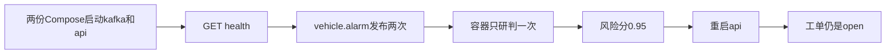

# 38 Kafka 接入容器

上一阶段是已完成的研判冒烟，见 [.cursor/plans/37-smoke-judgement.plan.md](.cursor/plans/37-smoke-judgement.plan.md)。本文件是阶段 38，落地到 [.cursor/plans/38-kafka-compose-ingest.plan.md](.cursor/plans/38-kafka-compose-ingest.plan.md)。确认本计划后，把正文写入该路径；若 Cursor 计划工具在用户全局 `~/.cursor/plans/` 留下副本，以仓库内文件为准并删除全局副本。下一阶段是 [.cursor/plans/39-online-model.plan.md](.cursor/plans/39-online-model.plan.md)。延续 [docs/vehicle-risk-agent-implementation-plan.md](docs/vehicle-risk-agent-implementation-plan.md) 第 28 节第 2 条和第 12 条。在线模型切换、`device.status` 触发诊断、`vehicle.location`、`media.ready`、`judgement.requested`、`judgement.completed`、`workorder.created`、手机使用、独立超速类型、驾驶员汇总、企业汇总、路线偏离、Redis、MinIO、StarRocks、Kubernetes、CI 和前端仍不纳入。

本阶段只证明一件事：加上接入文件后，`kafka` 和 `api` 一起起来，容器自己消费 `vehicle.alarm`。`fatigue_alarm_event()` 发布两次，只得到一次研判，`risk_score` 是 `0.95`，`task_id` 是 `evt_20261009_000001`。重启 `api` 后，卷里的 `wo-evt_20261009_000001` 仍是 `open`。图、分数、建单规则和工具数不变。`prompt_version` 仍是 `report-v6`。模型仍是 `fixture`。不新增 HTTP 路径。

原来的 lite 启动保持原样。[deployments/docker-compose.yml](deployments/docker-compose.yml) 的 `api` 不设置 `VEHICLE_AGENT_INGEST`，也不 `depends_on` Kafka。`docker compose -f deployments/docker-compose.yml up -d api` 仍只启动 fixture API。演示脚本那条高速报警的风险分仍是 `1.0`。

## 流程



## 接入文件

新增 [deployments/docker-compose.ingest.yml](deployments/docker-compose.ingest.yml)，只覆盖 `api`：

- `VEHICLE_AGENT_INGEST=kafka`
- `VEHICLE_AGENT_KAFKA_BOOTSTRAP=kafka:29092`（容器内走已有的 `PLAINTEXT://kafka:29092`；宿主机发布仍用 `127.0.0.1:9092`）
- `depends_on: kafka`
- 模型、监听地址、检查点路径和 `api-data` 卷沿用基础文件，不改 [deployments/Dockerfile](deployments/Dockerfile)

启动命令：

```powershell
docker compose -f deployments/docker-compose.yml -f deployments/docker-compose.ingest.yml up -d kafka api
```

不使用 profile。带 profile 且不点名服务时，Compose 会把没有 profile 的 Neo4j、Qdrant 和原来的 `api` 一起拉起，8000 端口会冲突。

## 连接重试

[src/vehicle_agent/kafka_alarm.py](src/vehicle_agent/kafka_alarm.py) 的 `serve_vehicle_alarms` 在连不上经纪人时会让守护线程退出，而 `GET /health` 仍返回 `ok`。`depends_on` 只表示进程已启动。在 [src/vehicle_agent/api/main.py](src/vehicle_agent/api/main.py) 的 `_serve_alarm_ingest` 外包一层重试：连接或轮询抛错时稍等再调用现有 `serve_vehicle_alarms`，直到 `stop`。非法 JSON 仍由 `handle_alarm_payload` 跳过。不改 `judge_consumed_alarm`、去重和偏移提交。消费组仍是 `vehicle-agent-alarm`。

## 验收

默认测试不构建镜像、不连接 Kafka。阶段 08 至 37 的既有测试保持通过。高速无图样例的 `risk_score` 仍是 `1.0`。`device.status` 仍不消费。

[tests/test_compose_acceptance.py](tests/test_compose_acceptance.py) 仍由 `VEHICLE_AGENT_RUN_COMPOSE=1` 决定是否运行。保留现有「只启动 api、风险分 1.0」那条。增加一条，使用独立项目名 `vehicle-agent-ingest`，避免清掉 lite 的 `api-data` 卷，也避免和默认项目抢同一条已提交偏移：

- 先 `down -v` 该项目，再按两份 Compose 文件 `up -d --build kafka api`。
- `GET /health` 返回 `ok`。
- 从宿主机向 `127.0.0.1:9092` 的 `vehicle.alarm` 发布 `fatigue_alarm_event()` 两次。轮询 `GET /api/v1/judgements/evt_20261009_000001`，`risk_score` 是 `0.95`，`risk_level` 是 `high`，状态是 `completed`。
- `GET /api/v1/workorders/wo-evt_20261009_000001` 的状态是 `open`。
- `restart api` 后再读这张工单，状态仍是 `open`，风险分仍是 `0.95`。
- `finally` 里 `down -v` 该项目。Docker 不可用时保持跳过，并在交付说明里写明原因。

更新 [README.md](README.md)：写明接入文件的启动命令、容器内经纪人地址，以及这条定样本的 `0.95` 和重启后仍为 `open` 的工单。lite 的单服务命令不变。排除项里删掉「lite 容器的 api 不连接 Kafka」这一条已由本阶段补上的缺口；在线模型切换、驾驶员汇总、企业汇总、路线偏离、`vehicle.location`、`media.ready`、`judgement.requested`、`judgement.completed`、`workorder.created`、Kubernetes、CI 和前端仍排除。把阶段 37 计划里的下一阶段指向本文件。

测试通过后按仓库规则提交一次中文 commit。阶段 38 的计划只保留仓库内的 `.cursor/plans/38-kafka-compose-ingest.plan.md`。
