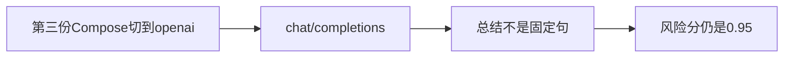

# 39 在线模型切换

上一阶段是已完成的 Kafka 接入容器，见 [.cursor/plans/38-kafka-compose-ingest.plan.md](.cursor/plans/38-kafka-compose-ingest.plan.md)。本文件是阶段 39，落地到 [.cursor/plans/39-online-model.plan.md](.cursor/plans/39-online-model.plan.md)。确认本计划后，把正文写入该路径；若 Cursor 计划工具在用户全局 `~/.cursor/plans/` 留下副本，以仓库内文件为准并删除全局副本。下一阶段本阶段不创建。延续 [docs/vehicle-risk-agent-implementation-plan.md](docs/vehicle-risk-agent-implementation-plan.md) 第 27.1 节：开发阶段可切换远程模型。`device.status` 触发诊断、`vehicle.location`、`media.ready`、`judgement.requested`、`judgement.completed`、`workorder.created`、手机使用、独立超速类型、驾驶员汇总、企业汇总、路线偏离、Redis、MinIO、StarRocks、Kubernetes、CI 和前端仍不纳入。不在本阶段部署 vLLM 或其它模型容器。

本阶段只证明一件事：`model_backend=openai` 时，现有疲劳研判仍把 `fatigue_alarm_event()` 打成风险分 `0.95`，总结来自 `chat/completions`，不是 [FIXTURE_REPORT](src/vehicle_agent/harness/model.py) 那句固定文案。图、分数、建单规则和工具数不变。`prompt_version` 仍是 `report-v6`。不新增 HTTP 路径。不改 [open_model](src/vehicle_agent/api/main.py) 的分支：`fixture` 仍返回固定总结，`openai` 仍使用 [OpenAICompatibleModel](src/vehicle_agent/harness/model.py)。报告节点已经从状态抄 `risk_score`，模型失败只让任务失败，不改分数。

原来的 lite 启动保持原样。[deployments/docker-compose.yml](deployments/docker-compose.yml) 仍把 `VEHICLE_AGENT_MODEL_BACKEND` 设为 `fixture`。`docker compose -f deployments/docker-compose.yml up -d api` 不调用在线模型。演示脚本那条高速报警的风险分仍是 `1.0`。阶段 38 的两份文件叠在一起时，若不加本阶段的第三份文件，模型仍是 `fixture`。

## 流程



## 模型文件

新增 [deployments/docker-compose.model.yml](deployments/docker-compose.model.yml)，只覆盖 `api`，不新增服务：

- `VEHICLE_AGENT_MODEL_BACKEND=openai`
- `VEHICLE_AGENT_MODEL_BASE_URL` 默认 `http://host.docker.internal:8001/v1`。容器内不能用 `127.0.0.1`，那会连到容器自己。可用启动前的同名环境变量覆盖。
- `VEHICLE_AGENT_MODEL_API_KEY` 默认 `local`，`VEHICLE_AGENT_MODEL_NAME` 默认 `qwen`。不把真实密钥写进文件，不另建 `.env`。
- `extra_hosts: host.docker.internal:host-gateway`，让 Linux 上的 Docker 也能解析这个名字。

启动命令在阶段 38 的两份文件后再叠这一份：

```powershell
docker compose -f deployments/docker-compose.yml -f deployments/docker-compose.ingest.yml -f deployments/docker-compose.model.yml up -d kafka api
```

不改 [deployments/Dockerfile](deployments/Dockerfile)，也不改 [deployments/docker-compose.ingest.yml](deployments/docker-compose.ingest.yml)。

## 验收

默认测试不构建镜像、不连接 Kafka、不连接在线模型。阶段 08 至 38 的既有测试保持通过。高速无图样例在 `fixture` 下的 `risk_score` 仍是 `1.0`。`device.status` 仍不消费。

在现有研判入口上增加一条进程内测试：`Settings(model_backend="openai")`，用 `httpx.MockTransport` 构造 `OpenAICompatibleModel`，交给现有 `create_app`。假响应是合法的 `summary` 与 `recommendations` JSON，句子和 `FIXTURE_REPORT` 不同。把 `fatigue_alarm_event()` 交给现有 `handle_alarm_payload`。`risk_score` 是 `0.95`，`risk_level` 是 `high`，状态是 `completed`，`requires_human_review` 是假，总结等于假响应里的句子。同一假模型再提交演示脚本那条车速 85、置信度 0.9 的报警，`risk_score` 仍是 `1.0`。请求路径以 `/chat/completions` 结尾，并带 `response_format.type=json_object`。

[tests/test_compose_acceptance.py](tests/test_compose_acceptance.py) 里另加一条，只在 `VEHICLE_AGENT_RUN_COMPOSE=1` 且 `VEHICLE_AGENT_RUN_MODEL=1` 时运行。使用项目名 `vehicle-agent-model`，叠三份 Compose 文件，`up -d --build kafka api`。从宿主机向 `127.0.0.1:9092` 发布 `fatigue_alarm_event()` 两次。`risk_score` 仍是 `0.95`，状态是 `completed`，总结不是 fixture 那句。`wo-evt_20261009_000001` 仍是 `open`。`finally` 里 `down -v` 该项目。未设置 `VEHICLE_AGENT_RUN_MODEL` 时跳过，并在交付说明里写明原因。实现时若本机 8001 没有可用的对话接口，保持跳过，不启动模型容器。9092 被占用时这条实机验收无法绑定端口，交付说明里写明。

更新 [README.md](README.md)：写明第三份文件、容器内默认模型地址，以及这条定样本在线模型下仍是 `0.95`、总结不再是固定句。lite 单服务命令不变。排除项里删掉在线模型切换；驾驶员汇总、企业汇总、路线偏离、`vehicle.location`、`media.ready`、`judgement.requested`、`judgement.completed`、`workorder.created`、Kubernetes、CI 和前端仍排除。把阶段 38 计划里的下一阶段指向本文件。

测试通过后按仓库规则提交一次中文 commit。阶段 39 的计划只保留仓库内的 `.cursor/plans/39-online-model.plan.md`。
