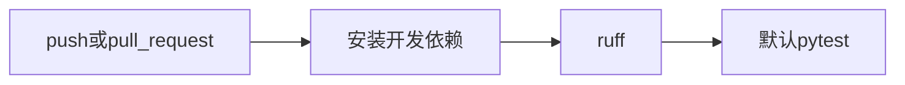

# 40 默认检查流水线

上一阶段是已完成的在线模型切换，见 [.cursor/plans/39-online-model.plan.md](.cursor/plans/39-online-model.plan.md)。本文件是阶段 40，落地到 [.cursor/plans/40-ci-check.plan.md](.cursor/plans/40-ci-check.plan.md)。确认本计划后，把正文写入该路径；若 Cursor 计划工具在用户全局 `~/.cursor/plans/` 留下副本，以仓库内文件为准并删除全局副本。下一阶段本阶段不创建。延续 [docs/vehicle-risk-agent-implementation-plan.md](docs/vehicle-risk-agent-implementation-plan.md) 第 26 节里的依赖安装、静态检查和单元测试。`device.status` 触发诊断、`vehicle.location`、`media.ready`、`judgement.requested`、`judgement.completed`、`workorder.created`、手机使用、独立超速类型、驾驶员汇总、企业汇总、路线偏离、Redis、MinIO、StarRocks、Kubernetes 和前端仍不纳入。不构建镜像，不部署，不新增 `uv.lock`。

本阶段只证明一件事：推送和拉取请求会在干净环境里执行与本机相同的默认检查，`ruff check src tests scripts` 和 `pytest`。不设置 `VEHICLE_AGENT_RUN_COMPOSE`、`VEHICLE_AGENT_RUN_KAFKA`、`VEHICLE_AGENT_RUN_NEO4J`、`VEHICLE_AGENT_RUN_QDRANT`、`VEHICLE_AGENT_RUN_MODEL`、`VEHICLE_AGENT_RUN_YOLO`、`VEHICLE_AGENT_RUN_VLM`、`VEHICLE_AGENT_RUN_FFMPEG`、`VEHICLE_AGENT_RUN_MCP`。这些实机验收因此继续跳过。不改研判、分数和 Compose。高速无图样例的 `risk_score` 仍是 `1.0`。定样本在 `fixture` 下仍是 `0.95`。

流水线使用 runner 上的临时环境，不使用本机 `D:\uv_venv`。

## 流程



## 工作流

新增 [.github/workflows/check.yml](.github/workflows/check.yml)。触发是 `push` 和 `pull_request`。一个作业，`ubuntu-latest`，Python 3.12，uv `0.9.5`，与 [deployments/Dockerfile](deployments/Dockerfile) 一致。用 `astral-sh/setup-uv` 安装，再在 runner 的虚拟环境里执行 `uv pip install -e ".[dev]"`。不安装 `vision` 额外依赖。

然后两条命令，工作目录是仓库根：

```text
uv run ruff check src tests scripts
uv run pytest
```

不声明 Kafka、Neo4j、Qdrant 服务，不构建 Docker 镜像，不设置上面的 `VEHICLE_AGENT_RUN_*` 变量。

## 验收

默认测试不连接 GitHub，也不需要仓库已有远端。阶段 08 至 39 的既有测试保持通过。

增加一条测试，读取 `.github/workflows/check.yml` 的文本：

- 含有 `uv run ruff check src tests scripts` 和 `uv run pytest`。
- 含有 Python `3.12` 和 uv `0.9.5`。
- 不含 `VEHICLE_AGENT_RUN_COMPOSE`、`VEHICLE_AGENT_RUN_KAFKA`、`VEHICLE_AGENT_RUN_NEO4J`、`VEHICLE_AGENT_RUN_QDRANT`、`VEHICLE_AGENT_RUN_MODEL`、`VEHICLE_AGENT_RUN_YOLO`、`VEHICLE_AGENT_RUN_VLM`、`VEHICLE_AGENT_RUN_FFMPEG`、`VEHICLE_AGENT_RUN_MCP`。
- 不含镜像构建步骤。

本机再跑一次 `ruff check src tests scripts` 和默认 `pytest`，确认这两条命令本身通过。不推送到远端；若本机没有 GitHub 远端，交付说明里写明流水线文件已在仓库内，尚未在 GitHub 上跑过。

更新 [README.md](README.md)：写明推送和拉取请求会安装 `.[dev]` 并执行上面两条命令，实机验收不在流水线里。排除项里删掉 CI；驾驶员汇总、企业汇总、路线偏离、`vehicle.location`、`media.ready`、`judgement.requested`、`judgement.completed`、`workorder.created`、Kubernetes 和前端仍排除。把阶段 39 计划里的下一阶段指向本文件。

测试通过后按仓库规则提交一次中文 commit。阶段 40 的计划只保留仓库内的 `.cursor/plans/40-ci-check.plan.md`。
