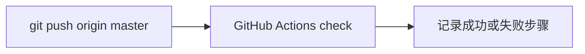

# 41 推送并确认 CI

上一阶段是已完成的默认检查流水线，见 [.cursor/plans/40-ci-check.plan.md](.cursor/plans/40-ci-check.plan.md)。本文件是阶段 41，落地到 [.cursor/plans/41-push-ci.plan.md](.cursor/plans/41-push-ci.plan.md)。确认本计划后，把正文写入该路径；若 Cursor 计划工具在用户全局 `~/.cursor/plans/` 留下副本，以仓库内文件为准并删除全局副本。下一阶段本阶段不创建。健康检查仍只表示进程在，不表示已连接 Kafka。经纪人对外地址仍是 `127.0.0.1:9092`。`device.status` 触发诊断、`vehicle.location`、`media.ready`、`judgement.requested`、`judgement.completed`、`workorder.created`、手机使用、独立超速类型、驾驶员汇总、企业汇总、路线偏离、Redis、MinIO、StarRocks、Kubernetes 和前端仍不纳入。

本阶段只证明一件事：`origin/master` 含有 `6ce3e36`，并且 [.github/workflows/check.yml](.github/workflows/check.yml) 在这次推送上跑完。不改应用代码、测试、Compose 和 README。不强制推送。

当前 `master` 比 `origin/master` 超前 22 个提交，工作区是干净的。最新提交是 `6ce3e36`，远端是 `https://github.com/Jintaimeng/vehicle-agent.git`。

## 流程



## 推送

在仓库根执行普通推送：

```powershell
git push origin master
```

推送前再看一次 `git status -sb`。若出现未提交改动，先停下并说明，不把它们混进这次推送。

## 确认

用 `gh run list` 找到这次推送触发的 `check` 作业，再用 `gh run view` 看结论。成功时在交付说明里写下运行链接和提交 `6ce3e36`。失败时只摘出失败步骤和日志里的错误，不在本阶段改研判或 Compose。若 `gh` 未登录，交付说明里写明推送结果和无法查询 Actions 的原因，不改 git 配置。

本阶段不提交新的代码 commit。阶段 41 的计划只保留仓库内的 `.cursor/plans/41-push-ci.plan.md`；这份计划文件本身不需要为了推送再做一次功能提交，除非它是推送前工作区里唯一的新文件。那种情况下单独提交这一份计划，再推送。
