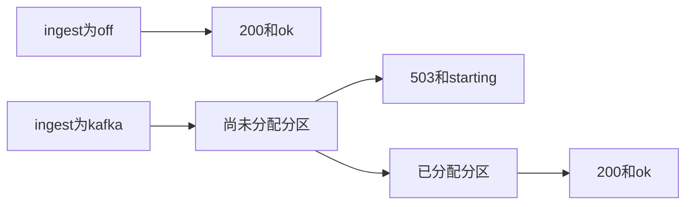

# 42 接入健康检查

上一阶段是已完成的推送确认，见 [.cursor/plans/41-push-ci.plan.md](.cursor/plans/41-push-ci.plan.md)。本文件是阶段 42，落地到 [.cursor/plans/42-ingest-health.plan.md](.cursor/plans/42-ingest-health.plan.md)。确认本计划后，把正文写入该路径；若 Cursor 计划工具在用户全局 `~/.cursor/plans/` 留下副本，以仓库内文件为准并删除全局副本。下一阶段是 [.cursor/plans/43-live-vision-judgement.plan.md](.cursor/plans/43-live-vision-judgement.plan.md)。延续 [docs/vehicle-risk-agent-implementation-plan.md](docs/vehicle-risk-agent-implementation-plan.md) 第 25.2 节里的 readiness。`device.status` 触发诊断、`vehicle.location`、`media.ready`、`judgement.requested`、`judgement.completed`、`workorder.created`、手机使用、独立超速类型、驾驶员汇总、企业汇总、路线偏离、Redis、MinIO、StarRocks、Kubernetes 和前端仍不纳入。不改 Kafka 广告地址，对外仍是 `127.0.0.1:9092`，只适合同一台机器。

本阶段只证明一件事：`ingest=off` 时 `GET /health` 仍是 `200` 和 `{"status":"ok"}`。`ingest=kafka` 时，消费组还没有分到分区就是 `503` 和 `{"status":"starting"}`；分到分区之后才是 `200` 和 `{"status":"ok"}`。图、分数、建单规则和工具数不变。`prompt_version` 仍是 `report-v6`。不新增其它 HTTP 路径。高速无图样例的 `risk_score` 仍是 `1.0`。定样本在 `fixture` 下仍是 `0.95`。

[deployments/docker-compose.yml](deployments/docker-compose.yml) 的健康检查只看 `urlopen` 是否成功。`503` 会让它失败，因此接入容器在连上经纪人之前是不健康的。lite 的 `up -d api` 不设置 `VEHICLE_AGENT_INGEST`，健康检查行为不变。不改 Compose 文件。

## 流程

## 状态

在 [src/vehicle_agent/api/main.py](src/vehicle_agent/api/main.py) 的 `create_app` 上放一个 `threading.Event`，交给现有接入线程。

[src/vehicle_agent/kafka_alarm.py](src/vehicle_agent/kafka_alarm.py) 的 `serve_vehicle_alarms` 增加可选回调。消费组 `assignment` 非空时调用它，表示已经分到分区。轮询错误仍跳过，不把错误当成已连接。非法 JSON 仍由 `handle_alarm_payload` 跳过。

`_serve_alarm_ingest` 在每次调用 `serve_vehicle_alarms` 之前清掉这个事件。连接或轮询抛错时也立刻清掉，再按现有间隔重试。进程停止时不再重试。

`GET /health`：

- `ingest` 不是 `kafka`：`200`，`{"status":"ok"}`。
- `ingest=kafka` 且事件未置位：`503`，`{"status":"starting"}`。
- 事件已置位：`200`，`{"status":"ok"}`。

不调用模型，不打开 Neo4j 或 Qdrant。

## 验收

默认测试不构建镜像、不连接 Kafka。阶段 08 至 41 的既有测试保持通过。

- [tests/test_api.py](tests/test_api.py) 里现有的 `GET /health` 仍是 `200` 和 `{"status":"ok"}`，因为测试应用的 `ingest` 仍是 `off`。
- 新增一条：`ingest=kafka` 的 `create_app` 在接入回调尚未发生时，`GET /health` 是 `503` 和 `{"status":"starting"}`。把事件置位后再请求，变成 `200` 和 `{"status":"ok"}`。不启动真实消费者。
- 扩展 [tests/test_alarm_ingest.py](tests/test_alarm_ingest.py) 里已有的重试测试：假的 `serve_vehicle_alarms` 第一次调用回调然后抛错，健康状态回到未连接；第二次正常返回并再次调用回调后，状态才是已连接。

[tests/test_compose_acceptance.py](tests/test_compose_acceptance.py) 不改断言。接入那条仍等到 `{"status":"ok"}`，因此现在也表示容器里的消费组已经分到分区。未设置 `VEHICLE_AGENT_RUN_COMPOSE` 时不跑。9092 被占用时跳过，并在交付说明里写明。

更新 [README.md](README.md)：`ingest=off` 时 `/health` 仍只表示进程可用；`VEHICLE_AGENT_INGEST=kafka` 时，尚未分到分区是 `503` 和 `starting`，分到之后才是 `ok`。排除项不变。把阶段 41 计划里的下一阶段指向本文件。

测试通过后按仓库规则提交一次中文 commit。阶段 42 的计划只保留仓库内的 `.cursor/plans/42-ingest-health.plan.md`。
