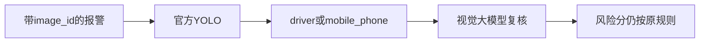

# 43 研判里的真实视觉

上一阶段是已完成的接入健康检查，见 [.cursor/plans/42-ingest-health.plan.md](.cursor/plans/42-ingest-health.plan.md)。本文件是阶段 43，落地到 [.cursor/plans/43-live-vision-judgement.plan.md](.cursor/plans/43-live-vision-judgement.plan.md)。确认本计划后，把正文写入该路径；若 Cursor 计划工具在用户全局 `~/.cursor/plans/` 留下副本，以仓库内文件为准并删除全局副本。下一阶段是 [.cursor/plans/44-kafka-advertised-host.plan.md](.cursor/plans/44-kafka-advertised-host.plan.md)。`device.status` 触发诊断、`vehicle.location`、`media.ready`、`judgement.requested`、`judgement.completed`、`workorder.created`、手机使用、独立超速类型、驾驶员汇总、企业汇总、路线偏离、Redis、MinIO、StarRocks、Kubernetes 和前端仍不纳入。不改 Kafka 广告地址。

本阶段只证明一件事：一条带 `image_id`、不带 `video_id` 的疲劳报警，会在现有研判图里调用官方预训练 YOLO，并在检出目标后调用视觉大模型做画面复核。图、分数、建单规则和工具数不变。`prompt_version` 仍是 `report-v6`。不新增 HTTP 路径，不改 [deployments/docker-compose.yml](deployments/docker-compose.yml)。高速无图样例的 `risk_score` 仍是 `1.0`。定样本在 `fixture` 下仍是 `0.95`。

仓库里的视觉定样本是标签 JSON，没有像素。官方 COCO 权重也不会输出 `closed_eye` 或 `yawn`，只经现有别名保留 `person` → `driver` 和 `cell phone` → `mobile_phone`。因此本阶段不读取 [src/vehicle_agent/knowledge/vision_fixtures](src/vehicle_agent/knowledge/vision_fixtures)，也不把照片提交进 Git。调用方自己放一张含有人或手机的 JPEG。纯色图检出为空，视觉大模型不会被调用，这条验收会失败。

## 流程



## 运行方式

不改 [src/vehicle_agent/knowledge/vision.py](src/vehicle_agent/knowledge/vision.py) 的类别映射，也不改 [src/vehicle_agent/graph/scoring.py](src/vehicle_agent/graph/scoring.py)。`model_backend` 必须是 `openai`。[FakeModelAdapter](src/vehicle_agent/harness/model.py) 会丢掉 `endpoint=vision`，固定总结下视觉大模型不会被调用。文本总结走 `VEHICLE_AGENT_MODEL_BASE_URL`，画面复核走 `VEHICLE_AGENT_VLM_BASE_URL`；两台地址可以相同，模型名也可以都指向同一个能看图的模型。

验收进程使用临时的 `vision_store_dir`。把样图复制成 `person-sample.jpg`，报警的 `image_id` 就是这个文件名。其余字段用演示脚本那条车速 85、置信度 0.9 的报警，身份仍是 `vehicle_001`、`driver_001`、`device_001`。入口是现有 `POST /api/v1/judgements`，应用由现有 `create_app` 按上述设置创建，不注入假模型。

权重默认是 `yolov8n.pt`。未设置 `VEHICLE_AGENT_YOLO_WEIGHTS` 时，由 ultralytics 在首次加载时下载这个官方文件，不写入仓库。设置了路径但文件不存在时跳过。样图默认 `data/vision-sample.jpg`，可用 `VEHICLE_AGENT_YOLO_IMAGE` 覆盖；文件不存在时跳过。

## 验收

默认 `pytest` 不加载 YOLO、不连接视觉大模型。阶段 08 至 42 的既有测试保持通过。GitHub Actions 仍不设置 `VEHICLE_AGENT_RUN_YOLO` 和 `VEHICLE_AGENT_RUN_VLM`。

新增 [tests/test_live_vision_judgement.py](tests/test_live_vision_judgement.py)。仅当两个开关都是 `1` 时运行：

- `VEHICLE_AGENT_RUN_YOLO=1`
- `VEHICLE_AGENT_RUN_VLM=1`

先安装 `.[vision]`。然后：

```powershell
$env:VEHICLE_AGENT_RUN_YOLO="1"
$env:VEHICLE_AGENT_RUN_VLM="1"
$env:VEHICLE_AGENT_VLM_BASE_URL="http://127.0.0.1:8001/v1"
$env:VEHICLE_AGENT_VLM_MODEL_NAME="qwen-vl"
$env:VEHICLE_AGENT_MODEL_BASE_URL="http://127.0.0.1:8001/v1"
$env:VEHICLE_AGENT_MODEL_NAME="qwen-vl"
$env:VEHICLE_AGENT_YOLO_IMAGE="data/vision-sample.jpg"
D:\uv_venv\Scripts\python.exe -m pytest tests/test_live_vision_judgement.py
```

对这次研判的图状态断言：

- `vision_status` 是 `hit`，检测非空，类别只出现在 `driver` 和 `mobile_phone` 中。
- `vlm_status` 是 `hit`，`vision_agreement` 是 `match` 或 `conflict`。证据来源是权重文件名，说明框来自这次 YOLO，而不是定样本目录。
- `risk_score` 仍是 `1.0`。
- 复核一致时，任务是 `completed`，总结不是 [FIXTURE_REPORT](src/vehicle_agent/harness/model.py) 那句固定文案。
- 复核不支持检测类别时，任务停在人工复核，不因此判失败，也不建单。

接口不可用、样图里没有人或手机、或返回不能解析的 JSON 时，这条验收失败。未设置两个开关时跳过，并在交付说明里写明。

更新 [README.md](README.md) 的图片视觉一节：写明这条研判验收、官方 `yolov8n.pt`、样图必须含有人或手机，以及文本和视觉可以共用一个兼容接口。排除项不变。把阶段 42 计划里的下一阶段指向本文件。

测试通过后按仓库规则提交一次中文 commit。阶段 43 的计划只保留仓库内的 `.cursor/plans/43-live-vision-judgement.plan.md`。
