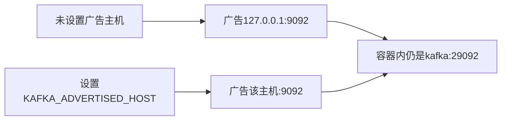

# 44 可配置的 Kafka 广告地址

上一阶段是已完成的研判真实视觉，见 [.cursor/plans/43-live-vision-judgement.plan.md](.cursor/plans/43-live-vision-judgement.plan.md)。本文件是阶段 44，落地到 [.cursor/plans/44-kafka-advertised-host.plan.md](.cursor/plans/44-kafka-advertised-host.plan.md)。确认本计划后，把正文写入该路径；若 Cursor 计划工具在用户全局 `~/.cursor/plans/` 留下副本，以仓库内文件为准并删除全局副本。下一阶段是 [.cursor/plans/45-ci-image-build.plan.md](.cursor/plans/45-ci-image-build.plan.md)。镜像构建、模型就绪检查、API 鉴权、`device.status` 触发诊断、`vehicle.location`、`media.ready`、`judgement.requested`、`judgement.completed`、`workorder.created`、手机使用、独立超速类型、驾驶员汇总、企业汇总、路线偏离、Redis、MinIO、StarRocks、Kubernetes 和前端仍不纳入。

本阶段只证明一件事：另一台机器上的生产者可以在启动前指定 Kafka 告诉客户端的宿主机地址。未指定时，[deployments/docker-compose.yml](deployments/docker-compose.yml) 仍广告 `127.0.0.1:9092`，现有从本机发布的验收不用改。容器内仍是 `PLAINTEXT://kafka:29092`。`api` 容器叠上接入文件后仍连接 `kafka:29092`。图、分数、建单规则和工具数不变。`prompt_version` 仍是 `report-v6`。不新增 HTTP 路径。高速无图样例的 `risk_score` 仍是 `1.0`。定样本在 `fixture` 下仍是 `0.95`。

Neo4j 口令仍写在 Compose 文件里，只给本机使用。不另建 `.env`，不把口令或模型密钥写进仓库。单节点和副本因子 1 不变。GitHub Actions 仍只跑 `ruff` 和默认 `pytest`，不构建镜像。

## 流程



## Compose

只改 [deployments/docker-compose.yml](deployments/docker-compose.yml) 里 `kafka` 的这一行：

```yaml
KAFKA_ADVERTISED_LISTENERS: PLAINTEXT://kafka:29092,PLAINTEXT_HOST://${KAFKA_ADVERTISED_HOST:-127.0.0.1}:9092
```

端口仍是 `9092`。启动时由当前 shell 传入 `KAFKA_ADVERTISED_HOST`，值为另一台机器能访问到的地址，不带协议和端口。不创建 `.env`。文件头继续写明 Neo4j 口令只限本机。不改 [deployments/docker-compose.ingest.yml](deployments/docker-compose.ingest.yml) 和 [deployments/docker-compose.model.yml](deployments/docker-compose.model.yml)。

本机命令不变：

```powershell
docker compose -f deployments/docker-compose.yml -f deployments/docker-compose.ingest.yml up -d kafka api
```

换机器时先设置广告主机，再执行同一条命令。容器内消费者仍走 `kafka:29092`，外部生产者连接 `KAFKA_ADVERTISED_HOST:9092`。

## 验收

默认测试不启动 Docker，也不连接 Kafka。阶段 08 至 43 的既有测试保持通过。`VEHICLE_AGENT_KAFKA_BOOTSTRAP` 的默认值仍是 `127.0.0.1:9092`。

新增一条测试，读取 `deployments/docker-compose.yml` 的文本：

- `KAFKA_ADVERTISED_LISTENERS` 含有 `PLAINTEXT://kafka:29092` 和 `PLAINTEXT_HOST://${KAFKA_ADVERTISED_HOST:-127.0.0.1}:9092`。
- 不再把宿主机广告地址写成写死的 `PLAINTEXT_HOST://127.0.0.1:9092`。
- 监听端口和宿主机映射仍是 `9092`。

[tests/test_compose_acceptance.py](tests/test_compose_acceptance.py) 不改断言。未设置 `KAFKA_ADVERTISED_HOST` 时，本机仍向 `127.0.0.1:9092` 发布，定样本风险分仍是 `0.95`。未设置 `VEHICLE_AGENT_RUN_COMPOSE` 时不跑。

更新 [README.md](README.md)：默认广告地址仍是 `127.0.0.1:9092`；换机器时在启动前设置 `KAFKA_ADVERTISED_HOST`。容器内地址不变。排除项里删掉「广告地址只适合同一台机器」这一条。镜像构建、模型就绪检查、API 鉴权、Kubernetes 和前端仍排除。把阶段 43 计划里的下一阶段指向本文件。

测试通过后按仓库规则提交一次中文 commit。阶段 44 的计划只保留仓库内的 `.cursor/plans/44-kafka-advertised-host.plan.md`。
