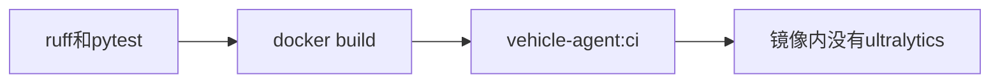

# 45 流水线构建镜像

上一阶段是已完成的 Kafka 广告地址，见 [.cursor/plans/44-kafka-advertised-host.plan.md](.cursor/plans/44-kafka-advertised-host.plan.md)。本文件是阶段 45，落地到 [.cursor/plans/45-ci-image-build.plan.md](.cursor/plans/45-ci-image-build.plan.md)。确认本计划后，把正文写入该路径；若 Cursor 计划工具在用户全局 `~/.cursor/plans/` 留下副本，以仓库内文件为准并删除全局副本。下一阶段本阶段不创建。模型就绪检查、API 鉴权、`device.status` 触发诊断、`vehicle.location`、`media.ready`、`judgement.requested`、`judgement.completed`、`workorder.created`、手机使用、独立超速类型、驾驶员汇总、企业汇总、路线偏离、Redis、MinIO、StarRocks、Kubernetes 和前端仍不纳入。不改 Kafka 广告地址。

本阶段只证明一件事：推送和拉取请求在 `ruff` 与默认 `pytest` 通过后，用现有 [deployments/Dockerfile](deployments/Dockerfile) 打出镜像 `vehicle-agent:ci`，并且这个镜像里没有 `ultralytics`。镜像只留在 runner 上，不登录仓库，也不推送。不改 Dockerfile：它仍然 `uv pip install --system --no-cache .`，不安装 `.[vision]`，`VEHICLE_AGENT_MODEL_BACKEND` 仍是 `fixture`。图、分数、建单规则和工具数不变。`prompt_version` 仍是 `report-v6`。不新增 HTTP 路径，不改三份 Compose 文件。高速无图样例的 `risk_score` 仍是 `1.0`。定样本在 `fixture` 下仍是 `0.95`。本阶段不推送 `master`。

## 流程



## 工作流

在 [.github/workflows/check.yml](.github/workflows/check.yml) 现有两条命令之后追加构建，仍是同一个 `ubuntu-latest` 作业。不设置任何 `VEHICLE_AGENT_RUN_*`。不使用 `docker/build-push-action`。

```text
docker build -f deployments/Dockerfile -t vehicle-agent:ci .
docker run --rm --entrypoint python vehicle-agent:ci -c "import importlib.util, os, sys; sys.exit(0 if importlib.util.find_spec('ultralytics') is None and os.environ.get('VEHICLE_AGENT_MODEL_BACKEND') == 'fixture' else 1)"
```

第二条覆盖镜像的启动命令，只做导入检查。`ultralytics` 不存在且模型后端是 `fixture` 时退出码为 0。

## 验收

默认 `pytest` 不构建镜像，也不连接 Docker。阶段 08 至 44 的既有测试保持通过。

改 [tests/test_ci.py](tests/test_ci.py)：工作流文本仍含 `uv run ruff check src tests scripts`、`uv run pytest`、Python `3.12` 和 uv `0.9.5`，仍不含那些 `VEHICLE_AGENT_RUN_*`。改为要求含有上面两条 `docker build` 和 `docker run` 命令。仍不含 `docker/build-push-action`，也不含 `.[vision]`。

更新 [README.md](README.md)：推送和拉取请求在默认检查通过后构建 `vehicle-agent:ci`，并确认镜像里没有 `ultralytics`、模型后端是 `fixture`。镜像不推送。排除项里删掉镜像构建；模型就绪检查、API 鉴权、Kubernetes 和前端仍排除。把阶段 44 计划里的下一阶段指向本文件。

测试通过后按仓库规则提交一次中文 commit。阶段 45 的计划只保留仓库内的 `.cursor/plans/45-ci-image-build.plan.md`。
