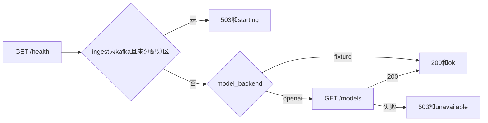

# 46 模型就绪检查

上一阶段是已完成的流水线镜像构建，见 [.cursor/plans/45-ci-image-build.plan.md](.cursor/plans/45-ci-image-build.plan.md)。本文件是阶段 46，落地到 [.cursor/plans/46-model-readiness.plan.md](.cursor/plans/46-model-readiness.plan.md)。确认本计划后，把正文写入该路径；若 Cursor 计划工具在用户全局 `~/.cursor/plans/` 留下副本，以仓库内文件为准并删除全局副本。下一阶段本阶段不创建。API 鉴权、`device.status` 触发诊断、`vehicle.location`、`media.ready`、`judgement.requested`、`judgement.completed`、`workorder.created`、手机使用、独立超速类型、驾驶员汇总、企业汇总、路线偏离、Redis、MinIO、StarRocks、Kubernetes 和前端仍不纳入。不改 Kafka 广告地址，不改 Dockerfile。

本阶段只证明一件事：`model_backend=openai` 时，`GET /health` 会请求 `VEHICLE_AGENT_MODEL_BASE_URL` 下的 `/models`。连不上、超时或状态码不是 200，返回 `503` 和 `{"status":"unavailable"}`；返回 200 时，健康检查才是 `200` 和 `{"status":"ok"}`。`model_backend=fixture` 时不发出任何模型请求，响应与现在相同。图、分数、建单规则和工具数不变。`prompt_version` 仍是 `report-v6`。不新增 HTTP 路径。高速无图样例的 `risk_score` 仍是 `1.0`。定样本在 `fixture` 下仍是 `0.95`。

不调用 `chat/completions`，不把视觉模型、Neo4j 或 Qdrant 算进这次检查。探测超时固定为 2 秒，短于 [deployments/docker-compose.yml](deployments/docker-compose.yml) 健康检查的 5 秒，因此不改 Compose。lite 容器的模型后端仍是 `fixture`，健康检查行为不变。叠上模型文件后，对话接口尚未返回 200 时，现有 `urlopen` 会因 503 失败，容器保持不健康。

## 流程

## 健康检查

在 [src/vehicle_agent/api/main.py](src/vehicle_agent/api/main.py) 的现有 `health` 上增加这次探测。Kafka 未分配分区仍先返回 `503` 和 `{"status":"starting"}`，此时不访问模型。

`model_backend=openai` 时，用 `httpx` 对 `VEHICLE_AGENT_MODEL_BASE_URL` 去掉末尾斜杠后的 `/models` 发 GET，带现有的 `Bearer` 密钥。超时 2 秒。连接失败、超时或状态码不是 200，都是 `503` 和 `{"status":"unavailable"}`。不读取响应正文，不调用 [OpenAICompatibleModel.complete](src/vehicle_agent/harness/model.py)。

## 验收

默认测试不连接 `127.0.0.1:8001`，也不构建镜像。阶段 08 至 45 的既有测试保持通过。

[tests/test_api.py](tests/test_api.py) 里现有的 `GET /health` 仍是 `200` 和 `{"status":"ok"}`，因为改为显式 `model_backend=fixture`。Kafka 那条在分到分区后仍是 `ok`，同样显式使用 `fixture`，避免探测默认的在线地址。

新增一条：`model_backend=openai` 时用假的 HTTP 传输。`/models` 返回 200，`GET /health` 是 `200` 和 `{"status":"ok"}`。同一应用下一次让传输抛出连接错误，再请求变成 `503` 和 `{"status":"unavailable"}`。请求路径以 `/models` 结尾，没有 `/chat/completions`。

更新 [README.md](README.md)：`fixture` 时 `/health` 仍不调用模型；`openai` 时 `/models` 不可用是 `503` 和 `unavailable`，返回 200 后才是 `ok`。Kafka 未分配分区仍优先返回 `starting`。排除项里删掉模型就绪检查；API 鉴权、Kubernetes 和前端仍排除。把阶段 45 计划里的下一阶段指向本文件。

测试通过后按仓库规则提交一次中文 commit。阶段 46 的计划只保留仓库内的 `.cursor/plans/46-model-readiness.plan.md`。
