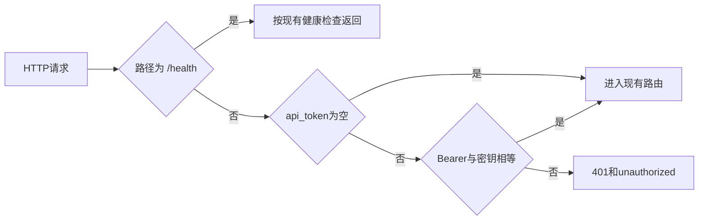

# 47 API 鉴权

上一阶段是已完成的模型就绪检查，见 [.cursor/plans/46-model-readiness.plan.md](.cursor/plans/46-model-readiness.plan.md)。本文件是阶段 47，落地到 [.cursor/plans/47-api-auth.plan.md](.cursor/plans/47-api-auth.plan.md)。确认本计划后，把正文写入该路径；若 Cursor 计划工具在用户全局 `~/.cursor/plans/` 留下副本，以仓库内文件为准并删除全局副本。下一阶段本阶段不创建。`judgement.completed`、`workorder.created`、`device.status` 触发诊断、`vehicle.location`、`media.ready`、`judgement.requested`、手机使用、独立超速类型、驾驶员汇总、企业汇总、路线偏离、Redis、MinIO、StarRocks、Kubernetes 和前端仍不纳入。不改 Dockerfile，不改健康检查命令，不改 Kafka 广告地址。

本阶段只证明一件事：`VEHICLE_AGENT_API_TOKEN` 非空时，凡路径以 `/api/` 开头的请求必须带 `Authorization: Bearer <token>`。缺失或不相等返回 `401` 和 `{"code":"unauthorized","message":"unauthorized"}`。该值为空（默认）时不检查，现有测试、演示脚本和未设置该变量的容器与现在相同。`GET /health` 在两种情况下都不检查。图、分数、建单规则和工具数不变。`prompt_version` 仍是 `report-v6`。不新增 HTTP 路径。高速无图样例的 `risk_score` 仍是 `1.0`。定样本在 `fixture` 下仍是 `0.95`。Kafka 消费不经过这层检查。

## 流程

## 检查

在 [src/vehicle_agent/config.py](src/vehicle_agent/config.py) 增加 `api_token: str = ""`。环境变量名是 `VEHICLE_AGENT_API_TOKEN`。

在 [src/vehicle_agent/api/main.py](src/vehicle_agent/api/main.py) 的 `create_app` 里，于注册路由之前加一个 HTTP 中间件。`api_token` 为空，或路径不是以 `/api/` 开头，直接放行。否则读取 `Authorization`，与 `Bearer {api_token}` 全等才放行。不匹配时直接返回上面的 `401` JSON，不读取正文，不写日志。密钥比较用 `hmac.compare_digest`。Kafka 接入线程仍调用图，不发 HTTP。

[deployments/docker-compose.yml](deployments/docker-compose.yml) 的 `api.environment` 增加 `VEHICLE_AGENT_API_TOKEN: ${VEHICLE_AGENT_API_TOKEN:-}`。未在宿主机设置时容器内仍是空字符串，健康检查仍请求 `/health`。不改 [deployments/docker-compose.ingest.yml](deployments/docker-compose.ingest.yml) 和 [deployments/docker-compose.model.yml](deployments/docker-compose.model.yml)。

## 验收

默认测试不设置 `VEHICLE_AGENT_API_TOKEN`。阶段 08 至 46 的既有测试保持通过。[scripts/demo.py](scripts/demo.py) 仍不带请求头。

在 [tests/test_api.py](tests/test_api.py) 新增一条：`api_token="secret"`。不带请求头的 `GET /health` 仍是 `200` 和 `{"status":"ok"}`。不带请求头，以及 `Authorization: Bearer wrong`，调用 `POST /api/v1/judgements` 都是 `401` 和 `{"code":"unauthorized","message":"unauthorized"}`。`GET /api/v1/workorders/missing` 在不带请求头时同样是 `401`；带 `Bearer secret` 时是现有的 `404`，证明检查覆盖 `/api/` 前缀，而不是只拦研判。同一客户端用 `Bearer secret` 提交现有车速 85、置信度 0.9 的样例，`risk_score` 仍是 `1.0`，并建出 `wo-{task_id}`。

更新 [README.md](README.md)：空密钥时 HTTP 与现在相同；设置 `VEHICLE_AGENT_API_TOKEN` 后，`/api/v1` 需要 `Bearer`，`/health` 不需要。curl 示例在该段注明要带这个头。排除项里删掉 API 鉴权；`judgement.completed`、Kubernetes 和前端仍排除。把阶段 46 计划里的下一阶段指向本文件。

测试通过后按仓库规则提交一次中文 commit。阶段 47 的计划只保留仓库内的 `.cursor/plans/47-api-auth.plan.md`。
