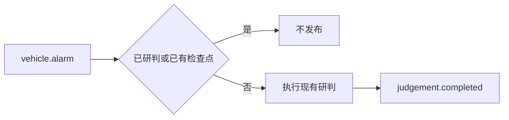

# 48 研判完成事件

上一阶段是已完成的 API 鉴权，见 [.cursor/plans/47-api-auth.plan.md](.cursor/plans/47-api-auth.plan.md)。本文件是阶段 48，落地到 [.cursor/plans/48-judgement-completed.plan.md](.cursor/plans/48-judgement-completed.plan.md)。确认本计划后，把正文写入该路径；若 Cursor 计划工具在用户全局 `~/.cursor/plans/` 留下副本，以仓库内文件为准并删除全局副本。下一阶段本阶段不创建。`workorder.created` 主题、`device.status` 触发诊断、`vehicle.location`、`media.ready`、`judgement.requested`、手机使用、独立超速类型、驾驶员汇总、企业汇总、路线偏离、Redis、MinIO、StarRocks、Kubernetes 和前端仍不纳入。不改 Dockerfile，不改健康检查，不改 API 鉴权，不改三份 Compose。

本阶段只证明一件事：消费 `vehicle.alarm` 并新执行一次研判后，向 `judgement.completed` 发布一条 JSON。字段是 `event_id`、`task_id`、`risk_score`、`requires_human_review`、`workorder_id` 和 `schema_version`。`schema_version` 固定为 `1.0`。没有工单时 `workorder_id` 为 `null`。同一个 `event_id` 已在本次进程的已研判表里，或检查点里已有这次研判时，不再发布。`POST /api/v1/judgements` 不发布。图、分数、建单规则和工具数不变。`prompt_version` 仍是 `report-v6`。不新增 HTTP 路径。高速无图样例的 `risk_score` 仍是 `1.0`。定样本在 `fixture` 下仍是 `0.95`，工单号仍是 `wo-evt_20261009_000001`。

发送失败时异常继续抛出，这条报警的偏移不提交。再次投递会碰到已有检查点，因此不会补发。本阶段不做发件箱。

## 流程

## 发布

在 [src/vehicle_agent/ingest.py](src/vehicle_agent/ingest.py) 增加完成事件和 `publish_judgement_completed`。它与现有 `publish_vehicle_alarm` 一样，把主题和字节交给调用方传入的 `send`。主题名是 `judgement.completed`。`risk_score` 与 `requires_human_review` 取自研判状态里的结果，`workorder_id` 取自状态；状态里没有工单号时写入 `null`。

在 [src/vehicle_agent/api/main.py](src/vehicle_agent/api/main.py) 的 `judge_consumed_alarm` 里，只有 `graph.invoke` 实际执行之后才发布。检查点已存在时仍直接返回 `event_id`，不发布。`ingest_alarm_payload` 把可选的 `send` 传进去；不传时不发布，现有测试保持不变。`create_judgement` 不调用这次发布。

`_serve_alarm_ingest` 传入的 `send` 调用 [src/vehicle_agent/kafka_alarm.py](src/vehicle_agent/kafka_alarm.py) 里的新函数。该函数用现有经纪人地址创建 `Producer`，生产这一条并 `flush`。`flush` 仍有未发出的消息时抛出 `TimeoutError`。默认测试不连接 `127.0.0.1:9092`。

## 验收

默认测试不设置 `VEHICLE_AGENT_RUN_KAFKA`。阶段 08 至 47 的既有测试保持通过。

在 [tests/test_alarm_ingest.py](tests/test_alarm_ingest.py) 新增一条：用假 `send` 消费定样本两次。第一次只追加一条，主题是 `judgement.completed`，JSON 里 `event_id` 和 `task_id` 都是 `evt_20261009_000001`，`risk_score` 是 `0.95`，`requires_human_review` 是 `false`，`workorder_id` 是 `wo-evt_20261009_000001`，`schema_version` 是 `1.0`。第二次不再追加。已有检查点的那条传入同一个假 `send`，列表仍为空。非法 JSON 仍不研判，也不发布。

再补一条线程测试：替换 `serve_vehicle_alarms`，让它用定样本调用两次 `handle`，并替换完成事件的生产函数。第一次调用生产函数，主题和正文与上面相同；第二次不调用。不连接经纪人。

更新 [README.md](README.md)：`VEHICLE_AGENT_INGEST=kafka` 时，新研判结束后发布 `judgement.completed`，重复的 `event_id` 不再发布。写出上面这条定样本的字段。排除项里删掉 `judgement.completed`；`workorder.created` 主题、Kubernetes 和前端仍排除。把阶段 47 计划里的下一阶段指向本文件。

测试通过后按仓库规则提交一次中文 commit。阶段 48 的计划只保留仓库内的 `.cursor/plans/48-judgement-completed.plan.md`。
