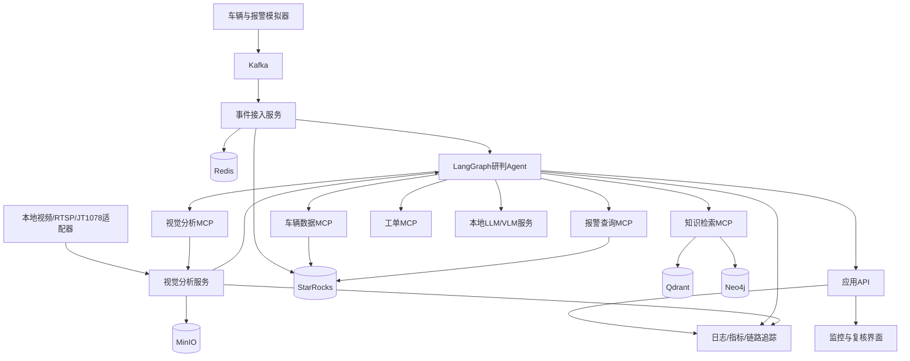
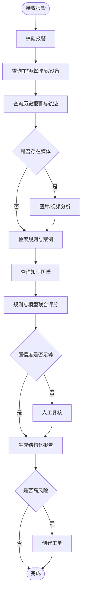

# 车联网多模态风险研判与运维智能体平台实施文档

## 1. 文档信息

- 项目名称：车联网多模态风险研判与运维智能体平台
- 项目代号：VehicleGuard AI
- 项目性质：面向 AI 大模型开发工程师岗位的工程化实战项目
- 建议周期：10～12 周
- 建议投入：每周 15～20 小时
- 主要语言：Python
- 核心框架：FastAPI、LangGraph、MCP、Qdrant、Neo4j、Kafka、Redis、YOLO、vLLM

## 2. 项目目标

建设一个可本地运行、可容器化部署、具备完整评测体系的车辆风险智能研判平台。平台接收车辆位置、设备状态、报警事件、抓拍图片和视频片段，通过 AI Agent 自动完成业务数据查询、视觉分析、行业知识检索、知识图谱推理、风险评级、处置建议生成及工单创建。

项目应重点证明以下能力：

1. 能够将车辆监控需求拆解为可执行的 Agent 工作流。
2. 能够设计工具、Skill、MCP Server 及其调用边界。
3. 能够实现 RAG、向量检索与知识图谱融合。
4. 能够处理文本、图片、视频等多模态数据。
5. 能够完成开源大模型部署和 Prompt 优化。文本侧 LoRA/QLoRA 对照实验已省略，见第 18 节。
6. 能够使用消息队列、缓存、分析数据库完成工程化数据链路。
7. 能够通过测试、评测、监控和 CI/CD 证明系统不是一次性 Demo。

## 3. 项目边界

### 3.1 本期范围

- 车辆、驾驶员、设备、轨迹和报警数据模拟
- 实时报警事件消费
- 报警自动研判 Agent
- 车辆风险画像与设备故障诊断
- 图片目标检测与视觉大模型复核
- 视频抽帧、目标检测和风险事件聚合
- 行业文档知识库
- 车辆监控领域知识图谱
- RAG 与知识图谱融合检索
- MCP 业务工具服务
- Skill 库
- 人工复核和工单闭环
- Docker Compose 本地部署
- Kubernetes 示例部署
- 自动化测试、评测、日志、指标和链路追踪

### 3.2 非本期范围

- 完整商业级 JT1078 平台
- 亿级车辆轨迹数据处理
- 自研通用大模型或视觉基础模型
- 完整地图和 GIS 平台
- 短信、电话等真实收费通知渠道
- 面向生产环境的多租户计费系统

JT1078 在第一阶段通过本地视频或 RTSP 流模拟，后续实现统一视频适配接口和简化 JT1078 接入适配器。这样既能体现协议接入能力，也能避免协议开发占用整个项目周期。

## 4. 典型业务场景

### 4.1 疲劳驾驶报警研判

系统收到疲劳驾驶报警后：

1. 查询车辆、驾驶员和设备信息。
2. 查询最近 30 分钟轨迹和历史报警。
3. 获取报警前后视频片段或关键帧。
4. 使用 YOLO 检测闭眼、低头、打哈欠等行为。
5. 使用视觉大模型复核驾驶员状态。
6. 检索疲劳驾驶监管规则和历史处置案例。
7. 查询车辆、驾驶员、设备与历史事件的图谱关系。
8. 计算报警可信度和风险等级。
9. 输出证据、结论和处置建议。
10. 低置信度结果转人工复核，高风险结果自动创建工单。

### 4.2 手机使用报警研判

结合目标检测结果、连续多帧命中情况、车辆速度和道路状态，判断驾驶员是否在行驶过程中使用手机，并排除手持其他物体导致的误报。

### 4.3 设备异常诊断

当同一设备短时间内大量报警或视频持续缺失时，Agent 查询设备状态、历史故障、固件版本和维修记录，判断是实际风险、摄像头遮挡、设备离线还是算法漂移。

### 4.4 车辆风险画像

按车辆、驾驶员、企业等维度汇总超速、疲劳驾驶、路线偏离、设备故障等事件，生成风险趋势、主要风险来源和治理建议。

## 5. 用户角色

- 监控人员：查看报警、证据和 Agent 研判结果，执行人工复核。
- 运维人员：查看设备异常原因、维修建议和历史记录。
- 企业安全管理员：查看车辆风险画像、趋势和整改建议。
- 系统管理员：管理知识库、模型、Prompt、MCP 工具和权限。
- 算法工程师：维护检测模型、评测集和模型版本。

## 6. 功能需求

### 6.1 报警中心

- 接收和展示实时报警
- 按车辆、类型、风险等级和时间筛选
- 查看报警图片、视频、轨迹和设备状态
- 展示 Agent 执行步骤、工具调用和证据
- 支持确认、驳回、补充意见和转工单

### 6.2 Agent 研判

- 支持自动触发和人工触发
- 支持多步骤状态化执行
- 支持工具超时、重试、降级和熔断
- 支持任务暂停、恢复和人工介入
- 支持结构化结论输出
- 支持执行过程审计
- 支持会话短期记忆和案例长期记忆

### 6.3 知识库

- 上传 PDF、Markdown、Word、HTML 等文档
- 文档解析、清洗、切分和元数据管理
- 向量检索、关键词检索和结果重排
- 返回原文引用和页码
- 支持文档版本更新和索引重建

### 6.4 知识图谱

- 管理车辆、驾驶员、设备、报警、规则、故障和维修记录
- 支持实体查询和关系追溯
- 支持从结构化业务数据构建图谱
- 支持从文档中抽取候选实体与关系
- 支持图谱证据与文档证据合并

### 6.5 视觉分析

- 图片目标检测
- 视频抽帧与批量推理
- 连续帧风险事件聚合
- 关键帧筛选
- 视觉大模型场景描述和复核
- 输出检测框、置信度、时间点及事件结论

### 6.6 运维分析

- 查询设备在线状态
- 分析频繁报警、视频缺失和传感器异常
- 关联固件版本、维修记录和同型号设备
- 输出故障原因排序和维修建议

## 7. 非功能需求

### 7.1 性能目标

- 普通文本研判平均响应时间小于 10 秒
- 包含图片的研判 P95 小于 30 秒
- 短视频异步研判在 2 分钟内完成
- 业务查询接口 P95 小于 500 毫秒
- 向量检索 P95 小于 1 秒
- Agent 工具调用成功率不低于 98%

以上目标用于单机开发环境验收，最终结果应记录测试硬件和并发条件。

### 7.2 可靠性目标

- 消息消费支持至少一次投递及业务幂等
- Agent 任务支持失败重试和断点恢复
- 模型不可用时能够降级为规则与检索模式
- 所有高风险自动操作默认支持人工确认
- 任务、工具调用、Prompt 和模型版本可追溯

### 7.3 安全要求

- MCP 工具按角色授权
- 敏感字段脱敏
- 文件上传限制类型和大小
- 外部输入进行 Prompt 注入检测
- 工具参数使用结构化 Schema 校验
- 创建工单等写操作需要显式授权
- 日志中不得记录密钥、完整证件号等敏感信息

## 8. 总体架构



## 9. 技术选型

### 9.1 后端与 Agent

- Python 3.11+
- FastAPI：业务 API 与微服务
- Pydantic：数据模型与工具参数校验
- LangGraph：可恢复、可观测的 Agent 工作流
- MCP Python SDK：MCP Server 和 Client
- SQLAlchemy：关系型数据库访问

选择 LangGraph 而非纯 ReAct 循环，是为了明确控制任务状态、分支、重试、人工审核和恢复流程。

### 9.2 模型与推理

- 文本模型：Qwen 系列 7B 级指令模型
- 视觉模型：Qwen-VL 或 InternVL
- 推理引擎：vLLM
- Embedding：中文或多语言 Embedding 模型
- Reranker：中文或多语言 Cross Encoder
- 微调方案：文本侧 LoRA/QLoRA 对照实验已省略，见第 18 节。不训练检测模型或视觉大模型。

模型必须通过配置切换，不将具体供应商和模型名称写死在业务逻辑中。

### 9.3 数据与中间件

- PostgreSQL：核心业务数据和任务元数据
- StarRocks：轨迹、报警和统计分析
- Qdrant：向量检索
- Neo4j：知识图谱
- Redis：缓存、短期状态和分布式锁
- Kafka：报警和设备状态事件
- MinIO：图片、视频和模型产物

### 9.4 视觉处理

- YOLOv8 或 YOLO11：目标检测
- OpenCV：图片与视频处理
- FFmpeg：转码、抽帧和流处理
- ByteTrack：可选目标跟踪

### 9.5 工程化

- Docker、Docker Compose
- Kubernetes
- Prometheus、Grafana
- OpenTelemetry、Jaeger
- GitHub Actions 或同类 CI/CD
- pytest、Ruff、mypy
- Locust 或 k6

## 10. 服务拆分

建议初期采用模块化单体加独立模型服务，功能稳定后再拆分。最终形成以下服务：

### 10.1 api-service

- 对外 REST API
- 身份认证和权限校验
- 报警查询与人工复核
- Agent 任务创建和状态查询

### 10.2 ingest-service

- 消费 Kafka 事件
- 校验和标准化数据
- 写入业务库与分析库
- 根据规则触发 Agent 任务

### 10.3 agent-service

- LangGraph 工作流
- Agent 状态持久化
- MCP Client
- 模型调用
- 风险评分和报告生成

### 10.4 vision-service

- YOLO 图片推理
- 视频抽帧和批量推理
- 目标跟踪与事件聚合
- VLM 关键帧复核

### 10.5 knowledge-service

- 文档导入与索引
- 混合检索与重排
- 图谱查询
- RAG 与图谱证据融合

### 10.6 mcp-servers

- vehicle-mcp
- alarm-mcp
- vision-mcp
- knowledge-mcp
- workorder-mcp

## 11. 数据模型

### 11.1 核心业务实体

#### Vehicle

- id
- plate_number
- vin
- enterprise_id
- vehicle_type
- status
- device_id
- created_at

#### Driver

- id
- name
- license_type
- risk_level
- enterprise_id
- created_at

#### Device

- id
- serial_number
- model
- firmware_version
- online_status
- last_heartbeat_at
- installed_vehicle_id

#### Alarm

- id
- vehicle_id
- driver_id
- device_id
- alarm_type
- alarm_time
- longitude
- latitude
- speed
- source
- raw_confidence
- status
- media_ids

#### JudgementTask

- id
- alarm_id
- graph_run_id
- status
- current_node
- retry_count
- model_version
- prompt_version
- started_at
- finished_at

#### JudgementResult

- id
- task_id
- risk_level
- alarm_validity
- confidence
- summary
- evidence
- recommendations
- requires_human_review

#### WorkOrder

- id
- alarm_id
- result_id
- type
- priority
- assignee
- status
- resolution

### 11.2 知识图谱实体

- Vehicle
- Driver
- Device
- Enterprise
- Alarm
- RiskEvent
- Regulation
- Fault
- MaintenanceRecord
- Firmware
- RoadSegment

主要关系：

```text
(Driver)-[:DRIVES]->(Vehicle)
(Vehicle)-[:INSTALLED_WITH]->(Device)
(Vehicle)-[:GENERATED]->(Alarm)
(Alarm)-[:INDICATES]->(RiskEvent)
(Alarm)-[:SUPPORTED_BY]->(Evidence)
(RiskEvent)-[:VIOLATES]->(Regulation)
(Device)-[:HAS_FAULT]->(Fault)
(Device)-[:USES]->(Firmware)
(Device)-[:HAS_MAINTENANCE]->(MaintenanceRecord)
(Enterprise)-[:OWNS]->(Vehicle)
```

## 12. 事件设计

### 12.1 Kafka Topic

- `vehicle.location`: 车辆位置
- `vehicle.alarm`: 车辆报警
- `device.status`: 设备状态
- `media.ready`: 图片或视频就绪
- `judgement.requested`: 研判请求
- `judgement.completed`: 研判完成
- `workorder.created`: 工单创建

### 12.2 报警事件示例

```json
{
  "event_id": "evt_20261009_000001",
  "alarm_id": "alarm_000001",
  "alarm_type": "driver_fatigue",
  "vehicle_id": "vehicle_001",
  "driver_id": "driver_001",
  "device_id": "device_001",
  "occurred_at": "2026-10-09T10:30:00Z",
  "location": {
    "longitude": 113.2644,
    "latitude": 23.1291
  },
  "speed_kmh": 82.5,
  "media_ids": ["media_001"],
  "source_confidence": 0.71,
  "schema_version": "1.0"
}
```

消费者以 `event_id` 或 `alarm_id + event_type` 作为幂等键。

## 13. Agent 设计

### 13.1 Agent 状态

```python
class JudgementState(TypedDict):
    task_id: str
    alarm: dict
    vehicle_context: dict
    driver_context: dict
    device_context: dict
    history: list[dict]
    visual_evidence: list[dict]
    retrieved_documents: list[dict]
    graph_evidence: list[dict]
    risk_score: float
    confidence: float
    result: dict | None
    errors: list[dict]
    requires_human_review: bool
```

### 13.2 工作流节点



### 13.3 路由原则

- 确定性业务查询优先调用工具，不允许模型编造。
- 计算风险分数使用规则或代码，不让模型直接给出最终数值。
- 模型负责意图理解、证据总结、解释和建议生成。
- 工具失败时记录错误并执行有限重试。
- 缺少关键证据或结论冲突时转人工复核。
- 写操作默认采用“生成建议—人工确认—执行工具”的流程。

### 13.4 结构化输出

```json
{
  "alarm_validity": "likely_true",
  "risk_level": "high",
  "confidence": 0.87,
  "summary": "驾驶员在车辆高速行驶期间出现持续闭眼行为。",
  "evidence": [
    {
      "type": "vision",
      "source": "video_001@00:13-00:18",
      "description": "连续5秒检测到闭眼，平均置信度0.89"
    },
    {
      "type": "history",
      "source": "alarm_history",
      "description": "该驾驶员7日内已有2次疲劳驾驶报警"
    }
  ],
  "recommendations": [
    "立即联系驾驶员并要求就近停车休息",
    "通知企业安全管理员复核"
  ],
  "requires_human_review": false
}
```

## 14. MCP 与 Skill 设计

### 14.1 MCP Server

#### vehicle-mcp

- `get_vehicle`
- `get_driver`
- `get_vehicle_location`
- `get_recent_trajectory`
- `get_device_status`

#### alarm-mcp

- `get_alarm`
- `list_recent_alarms`
- `get_alarm_statistics`
- `find_similar_alarms`

#### vision-mcp

- `analyze_image`
- `analyze_video`
- `get_visual_analysis`

#### knowledge-mcp

- `search_documents`
- `query_knowledge_graph`
- `get_regulation`
- `find_similar_cases`

#### workorder-mcp

- `create_workorder`
- `get_workorder`
- `update_workorder`

每个工具都应包含：

- 清晰的名称和职责
- JSON Schema 参数
- 权限要求
- 超时设置
- 幂等策略
- 错误码
- 可审计日志

### 14.2 Skill 库

#### alarm-verification

组合车辆查询、历史报警、视觉分析、规则检索和图谱查询，判断报警真实性。

#### vehicle-risk-profile

汇总车辆、驾驶员、报警和维修数据，生成风险画像。

#### device-diagnosis

分析设备状态、频繁报警、视频缺失、固件和维修记录，输出故障诊断。

#### alarm-root-cause-analysis

沿知识图谱追踪报警、设备、规则和历史案例，输出可能根因。

#### operation-report

按日或周汇总报警、风险趋势和处置效果。

Skill 定义至少应包含触发条件、输入、执行步骤、使用工具、输出 Schema、失败处理和评测案例。

## 15. RAG 与知识图谱融合

### 15.1 数据来源

- 道路运输监管规定
- 疲劳驾驶和超速判定规则
- 车辆监控报警处置流程
- 设备说明书
- 常见故障手册
- 历史报警与工单案例
- 自建业务规则文档

### 15.2 文档处理流程

```text
文件上传
→ 格式解析
→ 内容清洗
→ 标题与章节识别
→ 语义切分
→ 元数据补充
→ Embedding
→ Qdrant索引
→ 抽样质量检查
```

切分结果至少保留：

- document_id
- title
- section
- page
- effective_date
- document_type
- applicable_vehicle_type
- source_uri
- version

### 15.3 混合检索

1. 从用户问题和报警上下文提取实体与过滤条件。
2. 执行向量检索。
3. 执行关键词检索。
4. 使用 Reciprocal Rank Fusion 合并结果。
5. 使用 Reranker 重排。
6. 根据实体查询 Neo4j 关系。
7. 合并文档证据和图谱证据。
8. 生成带来源引用的答案。

### 15.4 图谱增强策略

- 从报警中识别车辆、驾驶员、设备和报警类型。
- 查询一到两跳邻居，避免无边界图遍历。
- 根据业务问题选择固定 Cypher 模板。
- 大模型只负责填充经过校验的查询参数。
- 图谱结果转化为可引用的结构化证据。
- 冲突证据必须在最终结果中显式说明。

### 15.5 防止幻觉

- 无来源的结论标记为推测。
- 关键事实必须关联工具结果或文档引用。
- 检索结果不足时明确回答“证据不足”。
- 法规类回答返回文档名称、章节和生效日期。
- 使用固定 JSON Schema 校验最终输出。

## 16. 视觉分析方案

### 16.1 第一阶段检测类别

- driver
- mobile_phone
- seat_belt
- closed_eye
- yawn
- smoking
- camera_occlusion

### 16.2 视频处理流程

```text
视频流/视频文件
→ FFmpeg解码
→ 按策略抽帧
→ YOLO批量推理
→ 可选目标跟踪
→ 连续帧规则聚合
→ 关键帧筛选
→ VLM复核
→ 事件结果入库
```

### 16.3 事件聚合示例

单帧检测到闭眼不直接判定疲劳驾驶。满足以下条件后生成候选事件：

- 连续命中时间超过阈值
- 多帧平均置信度达到阈值
- 车辆速度高于最低速度
- 摄像头未被遮挡
- 人脸区域质量满足要求

### 16.4 VLM 使用原则

- 只发送有代表性的关键帧，控制延迟和显存。
- Prompt 明确要求描述可见事实，不推测身份等不可见信息。
- 使用结构化输出。
- VLM 结果不能覆盖确定性的检测和业务数据。
- 保存模型版本、输入帧、Prompt 和输出用于回放。

## 17. Prompt 工程

### 17.1 Prompt 分层

- System Prompt：角色、边界、安全规则和输出要求
- Task Prompt：当前研判任务
- Context：工具结果、文档证据和图谱证据
- Output Schema：结构化输出定义

### 17.2 Prompt 版本管理

每个 Prompt 记录：

- prompt_id
- version
- applicable_model
- change_description
- created_at
- evaluation_result

Prompt 修改后必须执行固定评测集，不能仅凭个别案例判断效果。

### 17.3 注入防护

- 外部文档内容视为数据，不视为系统指令。
- 工具调用只能来自允许列表。
- 工具参数必须经过 Schema 校验。
- 对“忽略之前指令”等模式进行检测和记录。
- 高风险写操作不由模型直接执行。

## 18. 模型微调实验（已省略）

状态：省略。不实施，也不作为后续阶段的前置条件。

省略原因：文本模型当前只做两件事，把检测 JSON 改写成 `visible_facts`，以及在代码完成评分后编写 `summary` 和 `recommendations`。风险分、风险等级、置信度、报警有效性和是否人工复核都由代码决定。温度固定为 0，输出经过 JSON Schema 校验，检索和图谱查询也不由模型发起。微调这些文字改变不了研判结论。

报告里仍可能出现越权引用，例如没有法规摘录却写条款、没有图谱却编关系、没有视觉证据却编检测框或时间戳。这类问题用固定缺证据样本检查 JSON 通过率和越权引用即可，不需要对照训练。

以下为省略前的实验设计，仅作记录，不再执行。

### 18.1 实验目标

选择一个明确任务进行 LoRA/QLoRA 微调，例如：

- 报警类型与风险等级分类
- 研判报告结构化生成
- 车辆监控领域指令理解

### 18.2 数据集

- 训练集：人工构造与公开数据改写
- 验证集：与训练集车辆和案例隔离
- 测试集：固定、不参与调参
- 每条数据记录来源、标签依据和审核状态

### 18.3 对照实验

至少比较：

1. 基础模型零样本。
2. 基础模型加优化 Prompt。
3. LoRA 微调模型。
4. 微调模型加 RAG。

记录准确率、F1、JSON 格式通过率、幻觉率、延迟和显存占用。如果微调没有明显收益，应如实分析原因，而不是只展示训练日志。

## 19. API 初步设计

### 19.1 报警

- `POST /api/v1/alarms`
- `GET /api/v1/alarms`
- `GET /api/v1/alarms/{alarm_id}`

### 19.2 研判任务

- `POST /api/v1/judgements`
- `GET /api/v1/judgements/{task_id}`
- `POST /api/v1/judgements/{task_id}/retry`
- `POST /api/v1/judgements/{task_id}/review`

### 19.3 知识库

- `POST /api/v1/knowledge/documents`
- `GET /api/v1/knowledge/documents`
- `POST /api/v1/knowledge/search`
- `POST /api/v1/knowledge/reindex`

### 19.4 视觉分析

- `POST /api/v1/vision/images/analyze`
- `POST /api/v1/vision/videos/analyze`
- `GET /api/v1/vision/tasks/{task_id}`

### 19.5 工单

- `POST /api/v1/workorders`
- `GET /api/v1/workorders/{workorder_id}`
- `PATCH /api/v1/workorders/{workorder_id}`

## 20. 建议代码结构

```text
vehicle-guard-ai/
├── apps/
│   ├── api_service/
│   ├── agent_service/
│   ├── ingest_service/
│   ├── knowledge_service/
│   └── vision_service/
├── mcp_servers/
│   ├── vehicle_mcp/
│   ├── alarm_mcp/
│   ├── vision_mcp/
│   ├── knowledge_mcp/
│   └── workorder_mcp/
├── skills/
│   ├── alarm_verification/
│   ├── vehicle_risk_profile/
│   ├── device_diagnosis/
│   └── alarm_root_cause/
├── packages/
│   ├── domain/
│   ├── llm/
│   ├── observability/
│   ├── security/
│   └── shared/
├── prompts/
├── evaluations/
│   ├── datasets/
│   ├── rag/
│   ├── agent/
│   └── vision/
├── model_training/
├── simulators/
│   ├── vehicle_simulator/
│   └── video_stream_simulator/
├── deployments/
│   ├── docker/
│   └── kubernetes/
├── tests/
│   ├── unit/
│   ├── integration/
│   ├── contract/
│   └── e2e/
├── docs/
└── pyproject.toml
```

## 21. 实施计划

### 第 1 周：需求与基础工程

任务：

- 完成业务场景、领域模型和验收标准
- 初始化项目结构
- 配置代码规范、测试和 CI
- 使用 Docker Compose 启动 PostgreSQL、Redis、Kafka、Qdrant、Neo4j 和 MinIO
- 实现车辆、报警和设备数据模拟器

交付：

- 需求说明
- 架构图
- 可启动的基础环境
- 第一批模拟数据

验收：

- 一条模拟报警能够进入 Kafka 并持久化
- CI 能执行格式检查和单元测试

### 第 2 周：业务 API 与报警闭环

任务：

- 实现车辆、设备、报警和工单 API
- 实现报警列表与详情
- 实现人工研判和工单状态流转
- 建立统一错误码和日志格式

验收：

- 可以创建、查询并人工处理一条报警
- 核心 API 具备单元测试和接口文档

### 第 3 周：基础 Agent

任务：

- 实现 LangGraph 状态与检查点
- 实现车辆、驾驶员、设备和历史报警查询节点
- 实现结构化研判报告
- 实现超时、重试和人工审核分支

验收：

- 不依赖视觉和 RAG，也能基于业务数据完成基础研判
- Agent 中断后能够从检查点恢复

### 第 4 周：RAG

任务：

- 导入监管规定、设备手册和处置流程
- 实现文档解析、分块和 Qdrant 索引
- 实现混合检索、重排和来源引用
- 建立 RAG 基础评测集

验收：

- 监管规则问答能够返回正确章节和来源
- 固定评测集有可重复的 Recall@K 结果

### 第 5 周：知识图谱融合

任务：

- 建立 Neo4j Schema
- 导入车辆、驾驶员、设备和历史报警关系
- 实现受控 Cypher 模板
- 合并文档和图谱证据

验收：

- 能追踪“报警—车辆—设备—故障—维修记录”关系
- Agent 报告中能分别展示文档与图谱证据

### 第 6 周：MCP 与 Skill

任务：

- 将业务能力封装为五类 MCP Server
- 定义工具 Schema、权限、超时和错误码
- 实现 alarm-verification 与 device-diagnosis Skill
- 增加 MCP 契约测试

验收：

- Agent 通过 MCP 而非直接访问数据库完成核心查询
- MCP 服务故障时 Agent 能重试或降级

### 第 7 周：图片视觉分析

任务：

- 集成 YOLO
- 建立图片标注和测试样本
- 实现检测结果存储和可视化
- 接入视觉大模型进行复核

验收：

- 支持上传图片并返回检测框、类别和置信度
- YOLO 与 VLM 结果进入 Agent 证据链

### 第 8 周：视频分析

任务：

- 使用 FFmpeg/OpenCV 抽帧
- 实现批量推理与连续帧事件聚合
- 实现关键帧筛选
- 增加 RTSP 或循环视频流模拟

验收：

- 能从短视频中定位风险时间段
- 最终报告可引用关键帧和时间戳

### 第 9 周：微调与推理优化（已省略）

本周的文本侧 LoRA/QLoRA 对照实验已省略，原因见第 18 节。不构建微调数据集，不训练，不提交对照实验报告。吞吐量、延迟和显存改到模型实际接入或可观测性阶段记录，不单独作为微调实验的验收项。

以下为省略前的任务和验收，仅作记录，不再执行。

任务：

- 构建报警分类或报告生成数据集
- 完成 LoRA/QLoRA 实验
- 对比基础模型、Prompt、微调和 RAG
- 记录吞吐量、延迟和显存

验收：

- 提交完整实验报告
- 能解释微调是否值得用于该任务

### 第 10 周：可观测性与评测

任务：

- 接入 Prometheus、Grafana 和 OpenTelemetry
- 建立 Agent、RAG、视觉固定评测集
- 增加模型和 Prompt 版本追踪
- 进行故障注入和恢复测试

验收：

- 可以查看一次研判的完整调用链
- 可以定位最慢节点和失败工具
- 评测流程可重复执行

### 第 11 周：部署与压测

任务：

- 完善 Docker Compose
- 编写 Kubernetes Manifest 或 Helm Chart
- 实现健康检查和配置管理
- 执行 API、检索和 Agent 压测

验收：

- 新环境按文档可一键启动
- 输出吞吐量、P95、错误率和资源占用

### 第 12 周：文档与演示

任务：

- 清理演示数据和脚本
- 完成 README、架构和部署文档
- 编写技术决策记录
- 录制 3～5 分钟演示视频
- 准备面试讲解材料

验收：

- 评审者可以独立启动项目
- 演示覆盖报警接入、Agent、视觉、RAG、图谱、MCP 和工单闭环

## 22. 测试策略

### 22.1 单元测试

- 风险评分规则
- 文档切分
- Agent 路由条件
- 事件聚合
- 输入输出 Schema
- 权限校验

### 22.2 集成测试

- Kafka 生产与消费
- Qdrant 检索
- Neo4j 查询
- MCP Client 与 Server
- Agent 检查点恢复
- MinIO 媒体读写

### 22.3 契约测试

- MCP 工具参数和返回值
- Kafka 事件 Schema
- 服务间 API
- 模型结构化输出

### 22.4 端到端测试

至少覆盖：

1. 真实高风险报警。
2. 设备误报。
3. 缺少视频。
4. 模型服务超时。
5. 知识库无相关内容。
6. 文档与图谱证据冲突。
7. 低置信度转人工复核。
8. 高风险报警创建工单。

## 23. 评测体系

### 23.1 Agent

- 任务完成率
- 正确工具选择率
- 工具参数正确率
- 平均工具调用次数
- 无效循环率
- 人工转交率
- 端到端延迟

### 23.2 RAG

- Recall@K
- MRR
- NDCG
- 引用正确率
- 答案忠实度
- 无答案识别准确率

### 23.3 视觉

- Precision
- Recall
- F1
- mAP50
- 事件级误报率
- 事件级漏报率
- 单帧和视频吞吐量

### 23.4 业务结果

- 报警真实性判断准确率
- 风险等级准确率
- 误报过滤率
- 报告证据完整率
- 处置建议可执行率

评测集建议包含 50～100 个固定案例，并区分正常、真实风险、设备误报和证据不足。

## 24. 可观测性

### 24.1 日志

统一记录：

- trace_id
- task_id
- alarm_id
- graph_node
- tool_name
- model_name
- prompt_version
- latency_ms
- token_usage
- status
- error_code

### 24.2 指标

- Agent 任务数量与成功率
- 各节点耗时
- MCP 调用量、错误率和 P95
- 模型请求量、Token 和延迟
- Kafka 积压
- 检索延迟
- 视觉推理 FPS
- 人工复核率

### 24.3 链路追踪

一次研判应串联：

```text
报警接入 → Agent任务 → MCP调用 → 数据查询
→ 检索/图谱 → 模型推理 → 工单创建
```

## 25. 部署方案

### 25.1 本地开发

Docker Compose 启动基础设施和轻量服务，模型服务可根据 GPU 条件单独启动。

建议提供两种 Profile：

- `lite`：使用云端模型或较小模型，降低硬件要求。
- `full`：本地 LLM、VLM、YOLO 和完整中间件。

### 25.2 Kubernetes

- API、Agent、知识和视觉服务独立 Deployment
- Kafka、数据库可使用外部服务或 StatefulSet
- ConfigMap 管理普通配置
- Secret 管理密钥
- HPA 扩展无状态服务
- GPU 节点运行模型和视觉服务
- readinessProbe 与 livenessProbe
- PersistentVolume 保存模型和媒体文件

## 26. CI/CD

流水线至少包括：

1. 依赖安装。
2. 代码格式与静态检查。
3. 单元测试。
4. 集成测试。
5. 构建容器镜像。
6. 镜像安全扫描。
7. 部署测试环境。
8. 执行冒烟测试。
9. 手工批准后部署演示环境。

模型文件不直接提交 Git，通过对象存储或模型仓库管理。

## 27. 风险与应对

### 27.1 GPU 资源不足

- 优先使用量化模型
- 将 LLM/VLM 抽象为统一接口
- 开发阶段可切换远程模型
- 视频只选择关键帧调用 VLM

### 27.2 缺少真实车辆数据

- 建立可配置数据模拟器
- 使用公开视频和自制场景
- 明确标记合成数据
- 重点展示流程、评测和工程能力

### 27.3 系统组件过多

- 先完成模块化单体
- 按里程碑逐步引入组件
- 同类技术只选择一种深入实现
- 每增加组件都说明解决的问题

### 27.4 Agent 不稳定

- 使用显式状态图
- 限制最大步骤数
- 工具使用结构化参数
- 关键决策采用规则
- 引入人工审核和固定评测

### 27.5 RAG 效果不稳定

- 优化文档清洗与切分
- 使用混合检索
- 增加元数据过滤
- 引入重排模型
- 建立困难负样本

### 27.6 视觉误报

- 从单帧判断升级为事件级聚合
- 引入车速和时间上下文
- 使用 VLM 复核疑难样本
- 分析类别不平衡和场景偏差

## 28. 最终验收标准

项目完成时必须满足：

1. 模拟器可以持续产生车辆、设备和报警事件。
2. 一条报警可自动触发完整 Agent 工作流。
3. Agent 通过 MCP 获取业务数据和执行工具。
4. 图片或视频分析结果进入研判证据链。
5. RAG 返回可追溯的文档引用。
6. 知识图谱提供车辆、设备、故障和历史事件关系。
7. 系统可以区分高风险、低风险、误报和证据不足。
8. 低置信度任务进入人工复核。
9. 高风险任务可以创建工单。
10. Agent 失败后可重试或恢复。
11. 固定评测集可以一键执行并生成报告。
12. Docker Compose 可以启动演示环境。
13. 提供 Kubernetes 部署示例。
14. 提供架构、部署和评测文档。文本侧微调对照实验已省略，不要求微调文档。
15. 提供完整演示视频。

## 29. 求职成果物

最终仓库应重点展示：

- 一张清晰的系统架构图
- 一条完整的报警研判演示
- 一个可解释的 LangGraph 状态图
- 一套 MCP 工具和 Skill 定义
- 一份 RAG 与知识图谱融合设计
- 一份视觉模型评测报告
- 文本侧 LoRA 对照实验报告：已省略，见第 18 节
- 一份 Agent 与 RAG 自动评测报告
- 一份压力测试报告
- 一份线上故障模拟与复盘
- 一套 Docker/Kubernetes 部署文件
- 若干技术决策记录

面试时应能够重点讲清：

1. 为什么使用 LangGraph，而不是无限制 ReAct。
2. Tool、Skill、MCP 和 Agent 的职责边界。
3. RAG 与知识图谱如何互补。
4. 如何降低视频风险识别的误报率。
5. 如何让 Agent 可恢复、可审计、可评测。
6. 为什么省略文本侧微调，而用 Prompt、Schema 和代码评分约束模型输出。
7. 系统在高并发、模型超时和证据不足时如何降级。

## 30. JD 技术点覆盖

- 车辆动态监控：车辆、轨迹、报警、设备状态和风险画像
- 企业 Agent：需求拆解、架构设计、任务编排、工具调用和记忆管理
- 多步骤协同：报警研判、风险识别、设备诊断和工单闭环
- 多模态：文本、图片和视频融合分析
- 视觉模型：YOLO 检测、视频事件聚合和 VLM 复核
- JT1078：通过视频适配层和后续协议适配器覆盖
- RAG：文档处理、混合检索、重排、引用和评测
- 知识图谱：实体关系、图查询、证据扩展和报警溯源
- 向量数据库：Qdrant 部署、索引、过滤和调优
- MCP：业务工具封装、权限、错误处理和 Agent 集成
- Skill：报警核验、设备诊断、风险画像等业务能力
- Prompt：模板、版本、结构化输出、注入防护和回归评测
- 模型微调：文本侧 LoRA/QLoRA 对照实验已省略，见第 18 节
- 本地部署：vLLM、量化模型和模型服务化
- 数据中间件：Kafka、Redis、StarRocks、MinIO
- 工程化：Docker、Kubernetes、CI/CD、监控、压测和故障恢复

## 31. 实施原则

1. 优先完成一条端到端业务闭环，再扩充技术组件。
2. 每项技术都必须解决明确问题，不为堆栈而堆栈。
3. 所有模型输出都应可验证、可追溯、可评测。
4. 关键业务判断使用规则、模型和人工审核共同保障。
5. 每周产生可运行、可演示、可测试的增量。
6. 对未达到的指标和失败实验如实记录并分析。

完成该项目不能等同于真实的三年生产经验，但可以通过完整业务闭环、工程化设计、量化评测和技术决策，形成一份能够证明岗位匹配度的高质量项目案例。
